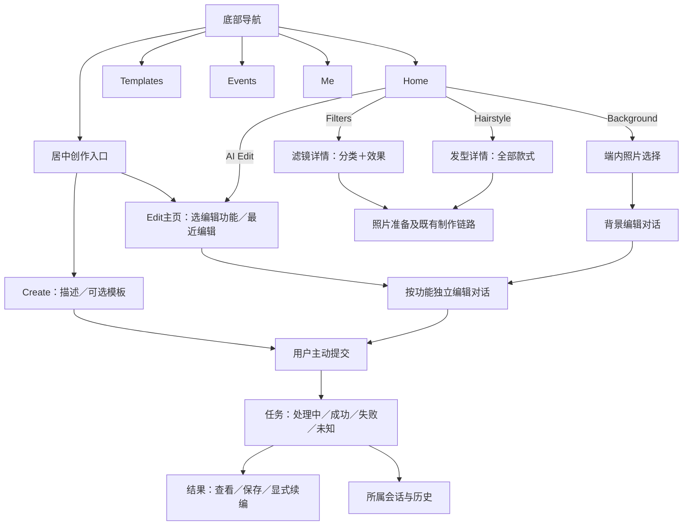
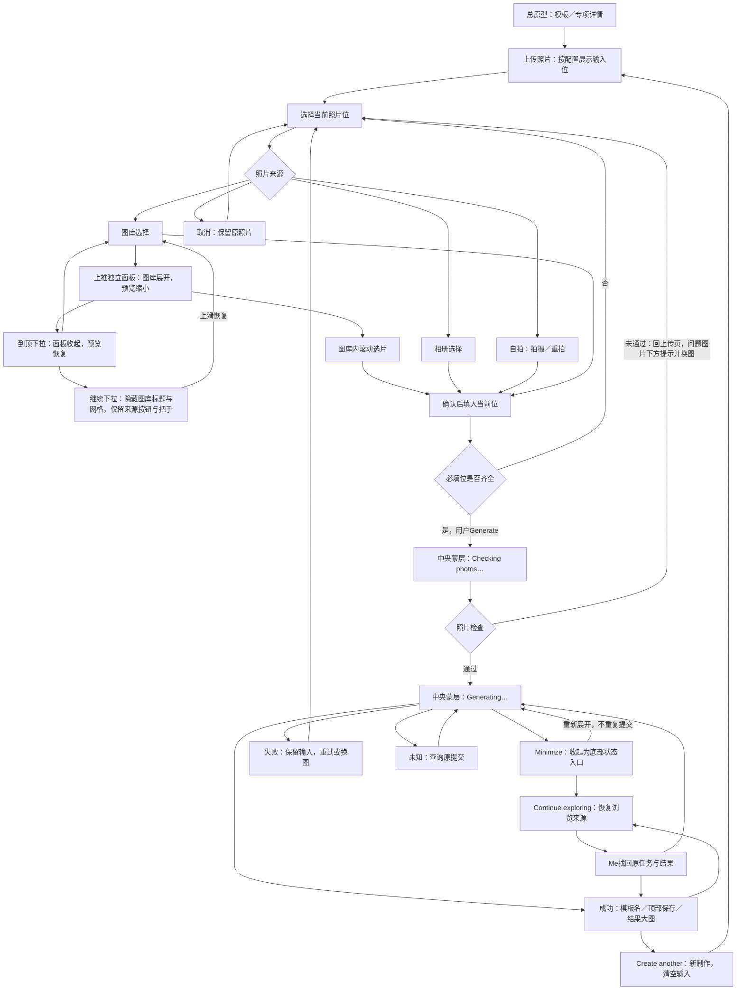
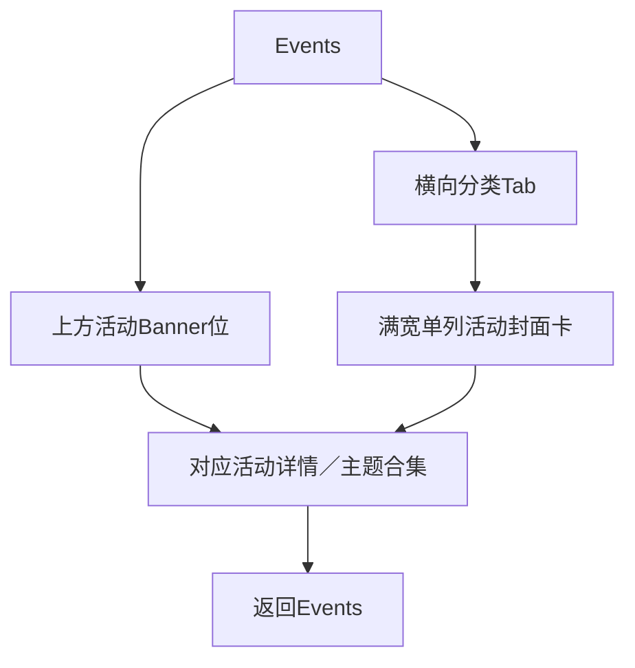

# 新产品需求文档｜当前整合版

更新：2026-11-21。**本文件是新产品当前需求的唯一正文。** 按功能维护，不按原型版本追加过程稿。

本文整理已讨论结论，没有新增上线承诺。**已确认**表示用户明确要求；**试行**表示已授权制作、待评审的细节；**待定**统一见[待定事项与需求待办](02_待定事项与需求待办.md)。当前并非研发冻结版，真实能力与验收另见[原型与验收入口](评审指南.md)。

## 1. 产品目标与边界

帮助用户通过模板、描述和自己的照片完成图片／视频创作及明确的照片编辑任务，减少重复上传、配置和切页。灵感浏览与任务入口并存；对话服务于产出，不增加长访谈、情绪分析或未经确认的自动执行。

这是独立新产品，名称与首发范围待定，不自动继承MuseMe的导航、会员、代币、新人福利或账户规则。原型在独立副本迭代，保留MuseMe冻结源文件。

当前需求覆盖Home、Templates、Create／Edit工作区、Events、Me及共用选片、任务、结果与历史。老照片修复、画质增强、宝宝预测、发型切换真实能力、灯光分别跟踪；候选功能不等于已确定上线。

## 2. 功能结构与主路径

图中滤镜／发型详情后的链路目前为制作演示；与Edit内部同名对话如何统一仍待定。Templates外部详情向Create传参也尚未形成全局契约。

| 页面编号 | 页面职责 | 关键入口与去向 |
| --- | --- | --- |
| GP-01 Home | 浏览精选、快捷选择任务 | Banner／精选进合集或详情；Edit photo进Edit主页；专项入口见第3节 |
| GP-02 Templates | 浏览图片／视频模板 | Photos／Videos、分类、模板内容；合集／详情／照片准备 |
| GP-03 Events | 发现经过策划的特色体验 | 上方活动Banner位＋下方统一活动列表；分类暂不冻结 |
| GP-04 Me | 找回个人内容 | 当前作品与分类；完整汇总Studio任务／草稿尚待接通 |
| AG-01 Create | 描述创作、模板辅助起步 | 图片附件、可选素材、设置、主动提交 |
| AG-02 Edit | 选编辑任务并持续修改 | 编辑主页→独立功能对话→结果 |
| AG-03 生成设置 | 修改当前稿输出与比例 | 输入框左下入口向上展开列表 |
| AG-04 视频素材预览 | 主动查看动态样片 | 与直接选用并行，不是前置步骤 |
| AG-05 结果预览 | 查看指定任务结果并交付 | 图片放大、视频播放、对比、保存 |
| AG-06 历史 | 恢复对话或定位作品 | 右侧历史栏；Edit最近编辑为快捷入口 |

## 3. 首页、模板与专项详情

### 3.1 全局导航与首页

**已确认：**底栏Home／Templates／居中创作／Events／Me同排；工作区内继续展示。Create／Edit独立工作区顶部切换，右上＋与History，不显示Back。再次点当前创作入口不重复打开。旧Creative／Tools中转页不恢复。

Home活动Banner嵌入页面，按用户要求支持多个活动轮播，每张进入对应合集。当前试作3张活动、左右滑动／圆点／键盘切换及5秒自动轮播；手动操作后暂停8秒，悬停、焦点在轮播内、页面隐藏或减少动态效果偏好时不自动切换。具体活动内容与自动轮播节奏待评审；快捷功能也可在首页展示。当前快捷区为Profile photo、Headshots、Transform、Background、Hairstyle、Filters六项，试作两行三列；重复的Edit photo已按用户要求移除，通用编辑由下方AI Edit进入。精选内容进入合集或详情，不恢复Recent photos墙。用户最新要求在首页功能区域增加独立Create／AI Edit按钮：并排位于具体功能捷径下方、精选内容上方，Create进入创作工作区，AI Edit进入编辑主页；不强制选图、不自动生成，保留原聊天与草稿。原“无双入口按钮”口径被本次明确要求替代。按钮材质、尺寸仍待视觉／体验评审。

| 首页操作 | 当前有效路径 | 取消、返回与保留 |
| --- | --- | --- |
| AI Edit | 进入Edit主页 | 不自动恢复上次编辑详情，旧稿与历史保留 |
| Background | 端内Choose your photo→选中可读取原图→背景对话 | 不增加确认／固定裁剪，不建立模板任务；选片返回留Home且不建空聊天；读取失败留选片页；编辑页返回Home并保留稿；再次点入口重新选图 |
| Filters | 统一Filters详情，默认All | Retro looks合并为其中复古分类，不再有独立快捷入口 |
| Hairstyle | 独立发型详情 | 不从Home直接跳到Edit；Edit内已有发型对话仍保留 |

### 3.2 Templates与通用模板链路

**已确认：**顶部Photos／Videos居中，下接分类和模板内容；无Explore标题、头部Banner或Creative页，旧featured链接回Photos。保留独立副本既有合集→模板详情→照片准备主链路。

**2026-11-21 用户最终限定照片模板详情改动范围：**仅调整底部红框操作区为Use template主按钮＋书签收藏按钮。图片卡片、顶部返回、标题、描述、渐暗蒙层、原有横向切换全部保持原布局；不采用全屏背景、独立关闭栏或圆点布局。用户进一步明确删除右上角爱心，收藏仅保留底部书签入口，沿用原收藏记录。使用进入当前模板的照片准备；未配置模板保持Preview only禁用。此规则覆盖此前扩大到整个页面的布局试稿。

照片模板详情→当前上传页→照片检查→生成→结果已于photo-flow-95接入总原型；描述创作仍由Create承接。字段、真实能力与Studio整体契约继续见Q-01／02／11，不因原型接通就认定服务完成。

**2026-11-21 用户最新明确：本步骤只上传照片，不展示目标效果。** 此决定替代此前第三种构图中“原图＋目标效果并排”的展示。效果在详情阶段已经看过，上传区只保留输入照片。

【本轮试作】单图一个居中照片位；双图两个并列照片位，不再增加目标效果或转换箭头。用户点击照片位确定当前输入位置，暖橙描边表示当前位。下方Photo library／Take a selfie与图库填入当前位，第一张填完自动定位下一个空位；已填照片可单独替换、移除；按用户最新要求移除照片下方独立放大按钮，不移动另一张。单图不显示Your photo等照片说明；双图的Photo 1／Photo 2分别在各自照片下方居中；已填照片的删除按钮叠放于各自预览区右上角，随预览缩放定位。两张要求必填的评审演示中，补齐后Generate可用；实际照片数量、人物角色、必填与同图复用规则仍由Q-02确认，不自动继承MuseMe。

**用户已确认同时支持相册上传与自拍。** Photo library打开系统照片／文件选择器；Take a selfie默认请求前置摄像头，拍照后Retake或Use photo，确认回填对应照片位。取消保留原有照片，不自动生成。相机权限在点击自拍时申请；取消或关闭释放摄像头，权限拒绝／设备不可用有重试及相册恢复。原生权限与真机拍摄仍待验证。

**用户新增要求：Recent photos作为可独立上滑的面板，上方输入预览随面板展开自适应缩小。** **用户最新确认：相册／自拍入口收进滑动面板，位于图库上方；收起时只显示Photo library／Take a selfie两个按钮与顶部拖动把手，隐藏Recent photos标题和图库，Generate固定在底部。**用户随后确认移除Recent photos右侧展开箭头，只保留顶部把手作为可见操作提示；拖动及点击面板头部的交互保留。

【本轮试作】把手拖动与图库上滑连续联动预览高度，松手吸附到展开／常规／底部收起三档；下拉先恢复大预览，继续下拉可隐藏图库标题与网格，仅保留面板内两个来源按钮和顶部把手。收起后上滑恢复常规图库，再上滑展开。展开后图库独立滚动，滚到顶部再下拉才收起；滚轮与点击把手也可操作，键盘支持三档切换，收起后的网格不可聚焦。上传页标题相对画板水平居中，左右保留返回与照片要求入口。单／双图共用此行为，选图、换位、移除后保留面板状态与可保留的图库滚动位置，不因滑动误选照片。三档行为已纳入用户要求；具体吸附阈值、缩小尺寸与动效为评审稿，真机手势和视觉仍待验。

**2026-11-21 用户给定中间态参考：**检查照片与生成均采用当前上传页面压暗的中央浮层，保留输入照片和图库布局，状态标题＋简短说明＋细进度条；沿用暖橙色。

【本轮交互试作】Generate先进入Checking photos…，通过后进入Generating…；检查未通过关闭浮层回到原上传页，不新增失败页面；保留全部输入，失败照片保持原尺寸和双图顶部对齐，仅用错误描边突出；在未通过的图片下方显示检测提示，相册／自拍／图库继续可用。更换该图后清除对应提示，不影响另一张；问题图片更换前Generate不可用。不进入生成。原页面在浮层下不可操作；生成中Minimize收起浮层为底部Generating…入口，可重新展开；收起不取消任务。检查阶段不提供取消；不定量进度条不显示百分比／剩余时间，真实服务有可靠进度时再评审数值。首版不主动取消／不自动排队规则保持。检查仍为计时演示；通过后创建本地演示任务，生成按本地时间推进。Minimize只收起状态层，Continue exploring恢复浏览来源，Me可找回同一任务／结果；刷新不新建提交。此为原型任务演示，不是真实后台服务。

【2026-11-21 用户最新确认｜成功页先与MuseMe保持一致】成功后顶部居中显示模板名，右上角为Save photo图标；主体为可点击放大的圆角结果大图，下方居中显示成功文案；底部并列Create another次按钮／Continue exploring主按钮。替代底部Save photo大按钮与Create again／Explore行。沿用新产品深黑／暖橙视觉，不自动继承MuseMe商业化或导航。

【2026-11-21 总原型接入】成功页按所选模板／专项风格展示对应名称和演示图，不再固定Golden Hour。Create another开启当前模板的新制作，回空上传页，清除输入及检测错误，需重新选择并手动Generate。Continue exploring按任务保存的来源恢复Home／Templates／Events及可保留位置；上传返回对应模板／头像／发型／滤镜／Transform详情并保留当前选择；从Me打开的任务顶部返回Me。旧照片准备与成功链接兼容转入本页，视频、Edit选图和情绪盲盒保留原契约。当前入口见03。

【本地任务演示】照片检查通过才创建生成任务；未通过保留输入与错误提示，不创建任务。生成任务保留模板、输入数量、浏览来源、来源参数及演示结果；输入照片本地存储，刷新／失败重试可恢复，保存失败或记录不存在时应提示重选，缺失任务不伪造成成功。生成中离页后可从Me找回，本地时间到达后呈现演示结果；失败按原输入创建关联原任务的新尝试，Me只展示重试链最新尝试；未知查询原任务，不重新提交。保存下载当前风格演示样片，不代表原生相册保存或真实生成结果。

【仍待确认／接入】本轮已完成原型合并，不代表Q-02输入输出矩阵、Q-05真实任务服务、Q-07生命周期／跨设备、Q-11 Studio完整汇总已关闭；不继承MuseMe付费规则，视觉及真机仍待用户评审。

### 3.3 Filters详情

**已确认方向：**大图前后对比、滤镜横向缩略图、多分类Tab，复古是滤镜分类。

当前结构：大图Before／After可拖动对比→当前滤镜名→分类Tab→横向滤镜列表→Use this filter。分类位于缩略图上方。选择分类／滤镜只更新预览，不自动生成；每分类保留当前会话上次选项，选片返回保留分类与滤镜。

All／Retro／Warm／B&W／Cool为试作分类，正式分类库待定。Use this filter当前进入统一上传与制作演示（保留滤镜／分类）；样片颜色预览不是用户照片的真实生成效果。与Edit内Filters对话的关系及最终提交方式尚待收束，不自行删除旧对话。

### 3.4 Hairstyle详情

**已确认：**大图横滑／前后对比→全部发型横向缩略图→Use this hairstyle；**不设置分类Tab**。选择与横滑同步预览，不自动选片或生成。Use this hairstyle进入统一上传与制作演示，返回恢复款式及Home／Events来源。旧分类参数忽略并移除。

现有bob／waves／pixie插画仅演示款式选择；真实同人物前后效果素材和发型能力待验证，不把插画当能力证据。

## 4. Create创作工作区（AG-01／03／04）

### 4.1 进入与布局

**已确认：**默认无模板、无照片、无提示词，素材面板收起。用户可直接描述，也可用模板辅助。输入框左下为加图图标、素材图标、输出／比例入口；右侧发送。顶部只有存在照片或模板时才显示对应内容，不留空标签行。

素材入口展开与输入框相连的整体面板：Photos／Videos Tab＋封面／名称横滑列表；箭头图标收起。收起不清模板、文字、照片、比例。已有会话保留操作后的面板状态；旧默认展开记录首次迁移为收起。

### 4.2 素材与草稿规则

| 操作 | 规则 | 必须保留／避免 |
| --- | --- | --- |
| 切Photos／Videos | 只筛选素材列表 | 不改已选模板、照片、描述、输出和比例 |
| 选模板 | 直接选用，不强制预览或确认；类型跟随模板；带入允许展示的完整可编辑描述 | 各会话按模板保存描述草稿；目标已有稿则恢复；保留当前照片和比例，不公开后台隐含约束 |
| 改描述 | 直接编辑完整文字 | 不擅自补创意；不提供Reset description |
| 换模板再切回 | 恢复该模板描述 | 不回退照片／比例，不串其他会话稿 |
| 清除模板 | 名称旁×解除关联；未改默认描述清空，用户改过的文字保留 | 照片、输出、比例和历史保留，不自动生成 |
| 添加／替换／移除照片 | 输入框紧凑附件，可预览、替换、移除 | 取消替换保留原图；读取失败保留其他输入；只改当前稿，不改已提交任务 |
| 不兼容照片／比例 | 就近提示修正，提交再校验 | 不静默删图、裁剪、重置；提供Change size |

模板可选；无模板时描述必填、照片可选，允许文字或图文生成。有模板按真实配置检查照片要求，当前演示模板均为单图必需，不外推成所有模式的限制。不恢复Your idea独立卡片、方向推荐或自动补创意流程。

### 4.3 参数与预览

无模板：Output可选Image／Video并调整Aspect ratio。有模板：输出随模板固定，仅调比例。清模板保留类型和比例，恢复Output选择。

入口位于左下工具栏，列表向上展开，无独立弹窗；选后即时生效，外部点击／Escape关闭，关闭不回滚。不能在生成中改动已提交任务。

原型Image比例3:4／1:1／4:3／9:16，Video比例9:16／16:9／1:1，仅作演示，正式输入输出矩阵待Q-02。

视频素材提供独立可选预览，不是点卡选用的前置；只有明确Use this style才选模板。关闭停止视频与声音，播放失败不静默换模板。

### 4.4 主动提交与再次创作

用户主动发送，校验描述、必需输入、模板有效性、类型与规格、真实服务条件；通过直接建任务，不增加汇总确认页。缺项定位且保留其他内容。若收费，按钮附近须有真实本次费用，不能按未知价格提交。

**试行S05：**结果Edit idea恢复整份任务输入：照片、描述、模板、输出、比例；覆盖不同当前稿前确认，取消保留稿。恢复不生成，用户修改后主动提交，在原对话追加关联任务，旧结果不变。区别于普通换模板只恢复描述。

**试行S07：**＋保存旧稿并新建空Create聊天，默认Image／3:4，重复空白不新增空聊天；正式默认比例待能力确认。

## 5. Edit编辑主页与对话（AG-02）

### 5.1 主页与独立对话

**已确认：**Edit主页先选功能，不默认进入某个工具。对话右上＋回Edit主页并保留旧稿、照片、结果。不同工具对应不同对话；旧聊天由历史恢复。

最近编辑采用左右横滑卡片。当前最多3条＋View all、照片／功能名／单行描述／状态／时间为试行；View all进入全部Edit历史并按最近更新排序。点卡恢复指定聊天，不新建对话或任务。无照片用占位，不拿效果图冒充上传图。

| 编辑功能 | 已确认范围 | 能力边界 |
| --- | --- | --- |
| Background | 用户照片＋背景模板或文字，完整描述可改 | 不增加用户效果参考图上传；真实主体保持待验证 |
| Hairstyle | 用户照片＋款式或文字，可表达发色、长短、卷直、刘海 | 不增加参考图上传；实际可用款式按效果收窄 |
| Filters | 固定可执行预设及已支持调整，不强制写一句描述 | 不以生成式换场景／重构光线冒充滤镜；无独立强度、百分比、Apply区 |

### 5.2 输入、工具与效果

照片在输入框内作为紧凑附件展示，可预览、替换、移除；上传后仍为待发送内容，与提示词一起提交。替换取消保留原图和文字；异步读取只回写发起操作的原聊天。

效果列表位于输入框外上方。背景／发型选效果只回填可编辑描述，不自动生成。收起／展开只用上下箭头，无文字，保留辅助阅读名称和44px点击区域；收起不清输入。

输入框只有一个工具入口，点击在上方内联展示工具列表，不用弹窗。当前功能名固定，不随面板改成Tools。**试行P-01：**工具与效果面板互斥；选当前工具回效果，不重复建聊天；选其他工具携当前底图新聊天，不带无关描述；再次点工具收起。默认展开、选后收起与键盘关系仍待评审。

### 5.3 生成与结果续编

背景／发型在照片及完整描述校验通过后显式提交，固定图文快照。背景发送后清已发文字／选中效果、收起列表但保留底图是**试行P-03**，不泛化到全部场景。

Filters先产生临时预览，不改底图、不算正式结果；旧异步预览不能覆盖新配置。**试行P-02：**输入框发送将当前快照渲染为正式结果，不强制描述；最终完成方式仍待评审，不能恢复已明确去掉的独立Apply／强度区。

**已确认EEXEC：**

- 完成后默认底图不变，不自动改用最新结果，不覆盖后来稿。
- 指定结果继续编辑：轻量选功能；同功能显式更新底图，跨功能携所选结果新聊天。取消不变稿，不绕回主页重新上传，不自动生成。
- 工具直接切换携当前底图；结果续编携指定结果，二者不可混用。
- 明确超出当前功能但已有支持时，给用户可点的跳转按钮，点击才携图与相关描述新聊天；含糊先澄清，不支持不给虚假能力。
- Before／After默认After；Before取该任务实际输入快照，不取当前草稿照片。

## 6. 共用任务、结果与历史（AG-05／06）

### 6.1 任务约束与状态

**已确认：**首版同时最多一个生成任务，无主动取消、不自动排队。接单后可准备下一稿、浏览素材、切工作区／历史或新建对话。完成写回所属聊天，其他位置只轻提示＋查看，不强跳、不清后来输入。不编造百分比或时长。

提交时固定照片、描述、模板／预设及配置版本、输出／比例、所属对话与来源任务；后来修改不能影响旧任务。

| 状态／动作 | 处理要求 |
| --- | --- |
| 缺项／不支持 | 就近提示，不建失败作品，不清其他字段 |
| 提交中／连点 | 防重复，确认接单状态；服务去重及计费契约待Q-05／06 |
| 超时／未知 | 查原提交，不当失败、不自动重发；查询失败仍未知 |
| 确定可重试失败 | 按原任务快照关联重试，不读后来稿；不承诺免费重试 |
| 必须改输入 | 明确原因与修改入口；保护不同当前稿，失效图不偷偷换样片 |
| 成功后加载／播放／保存失败 | 重取或重试同一结果，不新建生成，不转成生成失败 |
| 离开后完成 | 原任务更新，查看时保存当前稿再定位；忽略提醒不清结果 |

未知任务计入单未决限制、原快照重试和恢复确认为**S06试行**；实际限制范围和服务契约待核实。

### 6.2 结果查看与保存

打开指定结果预览，关闭回同一任务位置；图片放大、视频播放、Edit对比。视频默认静音，可开声音，关闭停止。手动Save／网页Download；Share本期不做。

仅实际平台需要时申请保存权限，不统一强制读取整个图库。保存实际选定结果，成功后才反馈成功。失效、权限、空间或下载异常保留成功任务并允许重试交付；网页下载不等于原生相册保存。真实格式、清晰度、水印待Q-04。

### 6.3 历史与数据保护

右上History打开右侧栏，关闭按钮／遮罩／Escape关闭。按Create／Edit恢复正确记录。选择聊天先保存当前稿再恢复目标；选择作品只定位任务，不覆盖当前稿。

**S07试行：**默认Chats；Creations按All／Images／Videos／Failed筛选，未知不归Failed。Create对话按创建时间倒序；Edit最近编辑按最近更新排序。标题取首次提交或草稿摘要，空内容为New chat，不加手动重命名。

正常原型以本地IndexedDB存照片、草稿与任务，不承诺云同步或永久保存。重进时处理中记录转未知并查询原任务，不假装页面计时器持续运行。存储失败明确反馈并降级页内使用。评审夹具与正常数据隔离，Reset preview只重置原型记录。

## 7. Events与Me

**2026-11-21授权试作：**Events定位为经过策划的体验发现页。Templates侧重查找效果，Events侧重呈现尝试理由、所需输入与结果；允许共享素材和主题合集，但不复制模板目录。季节、热门、合集可以是策划内容，不先冻结为分类Tab，不增加虚假热度、限时或奖励。

**用户已确认的结构：上方活动Banner位，下方活动列表。** Banner承接主推活动；活动列表统一承接特色玩法、季节活动或主题合集，不按内容类型拆成多个独立栏目。2026-11-21用户指定Banner下方参考横向分类Tab＋满宽单列封面卡布局；卡片标题叠在封面左下角，分类切换筛选同一列表。

| 区域 | 当前试作内容与去向 | 边界 |
| --- | --- | --- |
| 活动Banner位 | Meet another you，进入既有Transform详情 | 当前单张主推图；2026-11-21按用户要求缩小Banner占比，基准高度180px、短屏164px，其余内容与跳转保留；本地色彩布局样片，不证明真实AI生成 |
| 活动列表 | Find your next look → 独立发型详情；Little keepsakes → printed合集 | 一行一张满宽横向封面卡，名称与短说明叠在封面左下，卡间距12px、小圆角；发型为插画演示，合集为示例内容，具体运营配置待定 |

宝宝预测、老照片修复、灯光等未确认上线内容留在需求待办，不在本页以候选预告占位。Banner数量、是否轮播及活动排序待定，不新增轮播。分类先试作All／Hairstyles／Collections，可点击筛选；2026-11-21按用户要求精修Tab底纹：整行烟灰半透明表面、细亮边与轻内高光，选中项浅暖色胶囊代替下划线；仅视觉试作，待用户评审。具体名称与划分为建议，未冻结。不虚构使用量，待有真实统计后再决定是否展示。

详情保留Events来源，返回Events；首页原有入口返回Home。风格选择不得丢失来源。已有选片与生成链路仍按其原需求，未由本次新增能力。页面两层结构及Banner下方横向分类＋单列封面卡方向已由用户明确；具体分类、内容、排序及视觉细节仍为试稿，待用户评审。

Me标题My creations相对页面居中；收藏在左，人像图标在右，仍进入设置，辅助名称Profile and settings，不代表新增账户系统。Photos／Videos分段栏铺满内容区，左右20px与列表对齐、两项等宽，烟灰玻璃底纹＋暖橙选中态，无下划线。完整汇总Studio任务／作品／草稿仍是待完成目标。

## 8. 体验与视觉规则

产品界面en-US，内部需求／评审中文。去掉无用说明、晦涩词和重复入口，常用动作可用易识别图标；费用、权限、失败和恢复信息仍需明确。

402×874 pt为基准，复用同一布局适配375×667、440×956；静态导出@3x。保留系统时间／信号／电量，系统状态栏纯深黑。评审状态选择器置于产品画板外，不作为用户功能。

主色方向为深黑＋暖橙，当前试作背景#111112、容器#24201e、强调#f2b181；精确参数与以下材质仍待视觉验收：

| 区域 | 当前试作方式 |
| --- | --- |
| 底部导航 | 烟灰半透明、模糊、细亮边、内高光、柔和阴影；五位置不变，中央入口圆角方形 |
| Home快捷区 | 同材质，矩形面板圆角20px，不机械复制导航胶囊 |
| Create／Edit输入区、相连素材、参数列表 | 更深更轻的玻璃表面；照片清晰、发送暖橙实色；不扩展到所有消息／照片卡 |
| 合集、Filters、Hairstyle二级页 | 固定标题区深色向下透明渐变，内容从下方滚过，保留状态栏、返回和居中标题；不加独立Banner或硬分隔 |

渐变尚未套用照片准备、生成结果或无同类顶栏的模板详情。短屏键盘、焦点、长英文、44px触控和无整页横向溢出须实测，不能以自动测试代替用户视觉认可。

## 9. 需求核验清单

以下是后续核验标准，不表示已经全部通过。

| 编号 | 对应范围 | 通过标准 |
| --- | --- | --- |
| AC-01 | 导航／专项入口 | 工作区保留底栏无Back；AI Edit进主页；Background取消不建聊天；发型不直接进Edit |
| AC-02 | Create默认与素材 | 首次空白无模板、面板收起；分类只筛列表，收起不清稿；无模板可描述生成 |
| AC-03 | 模板选择／清除 | 换模板仅恢复对应文字；清模板按是否修改处理文字，照片／类型／比例保留 |
| AC-04 | 参数／输入 | 向上列表无弹窗；即时生效；不兼容不静默重置；取消换图保留稿 |
| AC-05 | Edit会话 | 工具内联且唯一入口；跨工具新聊天、旧稿可恢复，携底图不串描述 |
| AC-06 | 任务隔离 | 连点不重复；修改稿不影响快照；完成不覆盖新稿、不强跳；未知查询原提交 |
| AC-07 | 结果／历史 | 对比取任务输入；续编用指定结果；预览／下载异常不重新生成；作品定位不覆稿 |
| AC-08 | 专项详情 | 滤镜有分类且复古归属其中；发型无分类；选项不自动生成、选片返回保留 |
| AC-09 | 体验 | 三尺寸、键盘、英文、触控、状态栏和输入遮挡逐项验证；Me切换栏铺满 |
| AC-10 | 可交付边界 | 真实能力、规格、任务服务、费用、数据与保存权限完成待办核验后再冻结上线范围 |

确认依据和原始编号见历史讨论归档（保留在内部工作台）。后续规则改动直接修订对应章节；提案进待办，过程进历史，不在正文末尾持续堆“最新增量”。
