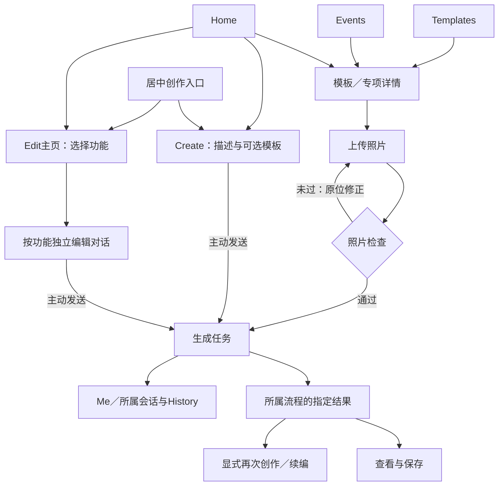
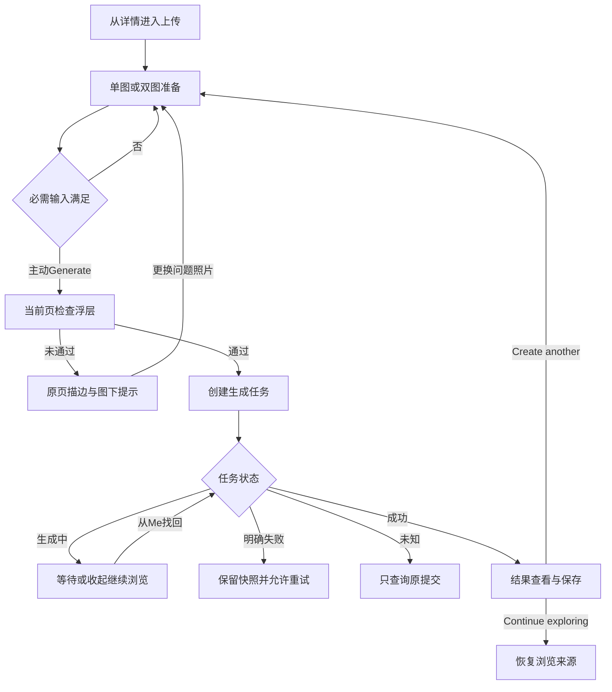
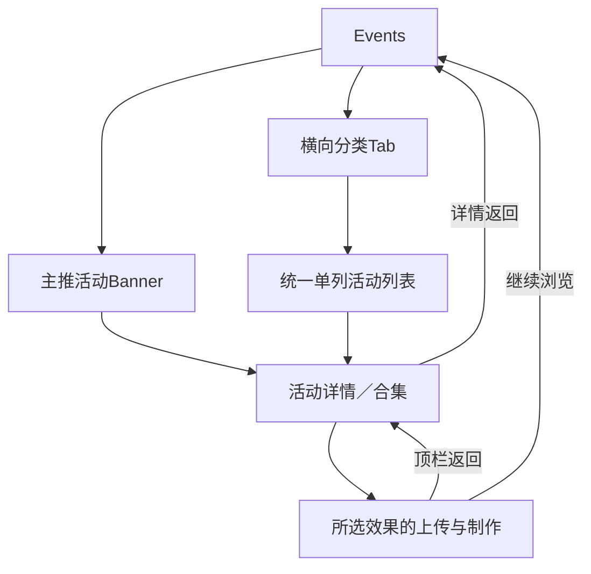

# 新产品｜需求详情

更新：2026-11-21。本文为当前唯一需求正文，在线需求详情、状态速查和下载稿均从本文生成。供产品评审、研发与测试按完整用户流程阅读，不以原型演示替代正式能力与验收。

阅读顺序：范围与整体流程 → 首页与入口 → 模板及专项详情 → 上传与照片检查 → 生成与异常恢复 → 结果交付 → Create → Edit → Events → Me与History → 设置 → 共用约束 → 待确认。

**状态口径：**【已确认】为用户明确要求；【试行】为已授权制作但尚待评审的交互；【原型观察】只记录现有演示，不能成为生产规则；【待确认】表示仍缺决定或服务事实。未明确标为已确认的原型默认值、排序、样片、时间或数量均不自动成为正式要求。需求、原型、真实接入、检查与用户验收分别记录，当前不是研发冻结稿。

## 1. 产品范围与整体流程

### 1.1 用户任务与产品边界

用户可以从喜欢的模板出发制作图片或视频，也可以在Create描述想法，或在Edit针对已有照片完成明确的编辑任务。产品帮助用户完成影像产出，减少重复上传、配置与切页；对话服务于产出，不增加长访谈、情绪分析或未经确认的自动执行。

新产品独立于MuseMe，名称和首发范围待确认，不自动继承MuseMe的导航、会员、代币、新人福利、账户或双人输入规则。综合修复、增强、宝宝预测和灯光不是当前已承诺能力。

### 1.2 核心路径与页面分工

**模板制作：Home／Templates／Events → 合集或专项详情 → 上传照片 → 检查 → 生成 → 结果 → 保存／再次制作／继续浏览。**

**描述创作：居中创作入口或首页Create → Create准备描述、可选照片与模板 → 主动发送 → 所属聊天收到结果 → 查看、保存或修改想法再创作。**

**照片编辑：首页AI Edit或工作区Edit → 编辑主页选功能 → 独立功能对话 → 准备照片和编辑要求 → 主动提交 → 查看、保存或显式携结果继续编辑。**

图中为功能关系。模板与专项详情直接制作、Create、Edit保留各自操作流程；它们之间的完整参数契约和Me汇总仍见Q-11，不因共用任务概念写成已经统一实现。

| 页面／环节 | 职责与功能清单 | 完成去向与边界 |
| --- | --- | --- |
| GP-01 Home | 活动轮播、六个专项捷径、Create／AI Edit、精选内容 | 合集、专项详情或工作区，不自动生成 |
| GP-02 Templates | Photos／Videos、分类、合集、模板详情与收藏 | 选择制作目标，进入相应准备流程 |
| GP-03 Events | 主推活动Banner、分类、单列活动卡 | 特色体验或合集，保留Events来源 |
| GP-04 Me | Photos／Videos作品、任务状态、收藏、设置 | 定位已有任务；Studio完整汇总尚未完成 |
| AG-01 Create | 描述、照片附件、可选模板、输出与比例、发送 | 在当前Create聊天产生关联任务 |
| AG-02 Edit | 编辑主页、最近编辑、功能对话、效果和工具、发送、续编 | 各功能独立聊天，指定结果可显式续编 |
| AG-03 参数 | 当前稿输出类型与比例 | 仅影响未提交草稿，不改旧任务 |
| AG-04 视频预览 | 查看素材样片、静音与关闭、明确选用 | 不作为选模板的强制前置 |
| AG-05 结果 | 指定任务预览、对比或播放、保存、后续动作 | 结果加载／保存失败不重新生成 |
| AG-06 History | 对话历史列表、恢复聊天及其中记录 | 先保护当前稿，不能被浏览历史覆盖 |

### 1.3 全局导航、进入与退出

【已确认】底部Home／Templates／居中创作／Events／Me同排，Create和Edit工作区内也继续展示底栏。工作区顶部Create／Edit切换，右上＋与History，不显示Back；旧Creative／Tools中转页不恢复。

| 功能／触发条件 | 操作与即时反馈 | 去向、数据与异常 |
| --- | --- | --- |
| 点击一级导航 | 打开相应一级页，不提交任务 | 已提交任务不取消；草稿与记录保护见第10、12章。跨启动是否恢复当前Tab、各列表滚动期限待Q-07／11 |
| 点击居中创作入口 | 进入创作工作区；再次点击当前入口不重复打开 | 不重复建聊天，不清当前稿；首次工作区默认及跨启动恢复的正式策略待Q-11 |
| Create／Edit顶部切换 | 切换独立工作区 | 不把Create描述写入Edit，不把一个功能的未发文字写入其他聊天 |
| 深入详情／准备流程 | 带入实际点击目标及浏览来源 | 返回恢复相应来源，不统一写成“回首页”；逐路径见第2～6、9章 |
| 无效模板或任务链接 | 不借用其他内容生成，不伪造成成功 | 给出不可用及回浏览的恢复入口；正式失效原因、文案与无来源兜底待Q-08／11 |

### 1.4 范围核验与待确认

| 给定条件 | 执行动作 | 应观察到的结果 |
| --- | --- | --- |
| 工作区有未发稿或进行中任务 | 切换底部Tab再回工作区 | 不重复提交、不取消任务；稿件不串工作区 |
| 当前已经位于创作工作区 | 再点居中入口 | 不多建空会话、不重置输入 |
| 从模板、描述或编辑起步 | 分别主动发起对应操作 | 只有显式Generate／发送才可能提交；选择素材或切Tab不生成 |

名称、首发能力与外部路径契约待Q-11；业务配置待Q-01／02，真实服务与商业化待Q-05／06。现有路由和本地样片不是正式服务承诺。

## 2. 首页与任务入口

### 2.1 本环节总览

用户进入Home时可能尚无创作目标，也可能要直接处理照片。首页用活动与精选帮助发现效果，用专项捷径与Create／AI Edit承接明确任务；不把照片图库当首页主体。

**主流程：浏览活动／精选 → 合集或详情 → 选择效果；或选择Create／AI Edit／专项捷径 → 对应工作区或详情。** 此环节不创建生成任务，照片只在实际制作需要时选择。

### 2.2 页面结构与功能清单

| 层级／区域 | 功能点 | 操作对象与位置 |
| --- | --- | --- |
| 页面顶部与底部 | 标题区、全局导航 | 一级页切换，不是生成参数 |
| 活动区 | 多活动封面、圆点、横滑 | 切当前活动，点击进入该活动合集 |
| 快捷区 | Profile photo、Headshots、Transform、Background、Hairstyle、Filters | 首页最多两行三列；超过6项显示All tools，底部面板展示全部；具体排序与组合待P-05 |
| 工作区入口 | Create、AI Edit | 并排位于专项捷径下、精选内容上 |
| 精选区 | 内容卡、关联合集入口 | 查看模板或合集，保留浏览来源 |

### 2.3 浏览活动与精选

【已确认】首页活动Banner嵌入页面并支持多个活动轮播，各项进入对应合集；精选内容进入合集或详情，不恢复Recent photos墙。

| 功能／出现条件 | 操作与反馈 | 去向、保留、取消／异常 |
| --- | --- | --- |
| 当前活动封面 | 点击当前活动 | 打开关联合集，记录Home来源与活动；不直接提交生成 |
| 活动横滑／圆点 | 横滑切活动，或点对应圆点 | 只更新当前活动与圆点，不跳页、不清工作区稿 |
| 自动轮播【试行】 | 当前三张，5秒切换；手动操作后暂停8秒 | 悬停、焦点在轮播内、页面隐藏或减少动态效果偏好时暂停；数量、时间、正式活动内容待P-05／Q-09 |
| 精选卡与合集入口 | 点卡进对应详情；点关联合集入口看全组 | 返回恢复Home及可保留位置；模板可制作性由配置决定，不因出现在精选就允许生成 |
| 图片／列表未就绪 | 区分加载中、内容为空和获取失败 | 不用其他模板冒充当前目标；正式空态、失败文案与重试入口仍待内容服务Q-08／11 |

### 2.4 明确任务入口

入口对应不同任务，不能因为标签类似就把它们接到同一页。

| 功能／出现条件 | 点击后的页面与操作 | 数据、取消与边界 |
| --- | --- | --- |
| Create | 进入Create工作区 | 不强制先选图、不自动生成，保留原聊天与草稿；第7章说明新稿与恢复 |
| AI Edit | 进入Edit主页 | 不自动进入上次功能详情，旧聊天与历史保留；不是重复的Edit photo快捷项 |
| Background | 打开端内Choose your photo，选可读取原图后进入背景对话 | 不加确认页／固定裁剪，不创建模板任务；取消留Home、不建空聊天；读取失败留选片；第8章说明附件和提交 |
| Profile photo | 进入头像专项承接页 | 专属输出与正式能力待Q-02／11，不能从头像示例推断实际交付规格 |
| Headshots | 当前原型为参考展示 | 不标为已接通的制作能力，首发范围待Q-11 |
| Transform | 进入对应专项详情，再由详情使用 | 带Home来源；实际能力和参数待Q-01／02 |
| Hairstyle | 独立发型详情 | 不从Home直接进入Edit；Edit内部已有发型聊天保留；第3章说明款式选择 |
| Filters | Filters详情，当前默认All | Retro looks归入滤镜分类，不另设重复入口；第3章说明预览与使用 |

#### 2.4.1 快捷功能超过6项时

【用户已确认｜2026-11-23】首页快捷区超过6个功能时提供展开按钮，点击从底部展出面板，展示全部编辑功能。

首页按当前可展示功能的配置顺序显示前6项，两行三列；All tools按钮单独位于快捷区底部，不占用或替代第6项。完整面板包含首页已展示的功能和其余功能，不只显示新增项，两处复用相同名称、图标、顺序与跳转配置。数量按实际可展示项计算；6项及以下不出现展开按钮，不留空按钮占位；具体功能清单和排序仍待P-05，本规则不新增任何编辑能力。

【本轮补齐方案／已实现原型】面板标题All tools，延续首页深色表面与暖色系统；三列排列，最大占屏约78%，更多项在面板内部纵向滚动。遮罩覆盖底部导航，背景不可点选、不可滚动。点击关闭按钮、遮罩或按Escape收起，恢复展开前首页滚动位置和展开按钮焦点，不创建任务、不改变工作区草稿。面板内点选功能，先收起面板，再执行第2.4节对应入口流程；返回首页保持来源和可保留位置，不自动重开面板。Background仍先选片，取消选片留首页，不重新展开面板。刷新／切换首页时面板默认关闭。面板提供独立滚动、键盘焦点约束及减少动态效果支持。

当前原型有6项，默认无展开按钮；toolsPanel=1只用于评审面板视觉，不计入产品入口或能力清单。超过6项的展开条件通过配置边界检查验证，不能为展示按钮而虚构首发功能。

### 2.5 返回与状态保留

从Home进入详情的顶部返回回Home；通过详情继续上传时，上传返回该详情，Continue exploring恢复Home及任务记录的可保留位置。Background选片取消保持Home，成功进入背景对话后返回来源仍为Home且保留稿；再次点击Background重新选择照片，不自动复用旧输入。独立工作区常规顶部无Back，专项来源的返回是特定承接，不能据此给全部工作区增加Back。

### 2.6 状态与规则速查

| 条件／状态 | 页面反馈 | 允许操作与去向 | 任务／数据影响 |
| --- | --- | --- | --- |
| 快捷功能≤6项 | 最多展示6项，无展开按钮 | 点击对应功能 | 不建任务，不改草稿 |
| 快捷功能>6项 | 显示前6项及All tools | 点击从底部展开全部功能 | 不替换第6项，不建任务 |
| 全部功能面板展开 | 三列完整功能，超长内部滚动 | 点功能跳转；关闭／遮罩／Escape收起 | 背景不可交互；收起恢复Home位置和焦点 |
| 正常浏览 | 展示活动、快捷入口、工作区入口、精选 | 切活动、打开关联内容 | 不建任务，不清工作区稿 |
| 轮播暂停条件成立【试行】 | 当前活动不自动切换 | 可主动横滑／点圆点 | 不改当前制作目标 |
| Background选片取消 | 保持Home | 再次选择或去其他入口 | 不建空聊天，旧稿保留 |
| Background图片读取失败 | 留在选片环节并提示 | 重选或返回Home | 不用样片替代输入 |
| 内容加载／空／失败【待确认】 | 原型可演示三类状态 | 真实重取与空态去向待Q-08／11 | 不产生失败作品 |

### 2.7 验收场景与交付边界

| 给定条件 | 执行动作 | 可观察结果 |
| --- | --- | --- |
| 分别配置6项、7项及更多快捷功能 | 查看首页，再打开面板 | 6项无展开按钮；超过6项首页仍为6项，面板完整展示且可滚动 |
| 面板打开且Home已有滚动位置 | 关闭／点遮罩／Escape，再次打开并选Background | 关闭恢复位置和焦点；选功能先收面板再选片，取消不建空聊天 |
| Home有多个活动 | 手动切换后点击当前项 | 圆点、封面与目标合集一致；不点击旧活动目标 |
| 未选择任何照片 | 点Create，再回Home点AI Edit | 前者进入可描述的Create，后者进入Edit主页，均未自动生成 |
| 有旧背景聊天 | 从Home点Background后取消选图 | 留Home，不新增空聊天，旧聊天仍可找回 |
| 从Home进发型或滤镜 | 选款式、上传后返回详情 | 所选款式／分类与Home来源保留，不跳错Edit聊天 |

轮播节奏与快捷区视觉为试行P-05／06；内容加载服务、无效配置与Headshots首发范围待Q-08／11。本章不为未接入的功能补造执行能力。

## 3. 模板目录、合集与专项详情

### 3.1 本环节总览

用户需要先理解可获得的效果，再决定是否上传。Templates用于按媒体与分类查找；合集缩小浏览范围；详情说明当前效果并选择制作目标。上传页只处理输入，不重复承担目标效果展示。

**主流程：Photos／Videos → 分类或合集 → 具体详情 → 明确使用 → 对应输入准备。** 图片走第4～6章；视频仍使用既有独立演示承接，其正式输入输出、与新产品工作区的统一待Q-02／11，不能把照片新流程自动套给视频。

### 3.2 目录与合集功能

【已确认】顶部Photos／Videos居中，下接分类和模板内容；不设置Explore标题、头部Banner或Creative中转页。旧featured链接兼容Photos。

| 功能／条件 | 操作与反馈 | 去向、保留与异常 |
| --- | --- | --- |
| Photos／Videos | 点击切媒体目录，只展示对应模板 | 不混用两类制作配置，不自动选择模板；切换时分类与滚动的正式保存期限待Q-07／11 |
| 分类Tab | 点击筛选当前媒体的内容 | 不提交、不自动跳详情；名称、顺序、空分类策略待正式内容配置 |
| 合集入口 | 点合集标题／入口进入其模板列表 | 带合集标识、来源页、被点项；返回恢复原来源及可保留浏览位置 |
| 模板封面 | 点击当前卡片，打开对应详情 | 被点项为初始目标；封面比例不能代替输出比例或输入数量 |
| 无可制作配置 | 可以展示样例，不开放制作 | 详情使用按钮为Preview only禁用，不借用别的模板生成 |
| 内容空／加载失败 | 区分目录无内容与服务未取到内容 | 不用其他分类填充；正式重试、缓存与文案待Q-08／11 |

【原型观察】目录与合集复用既有内容展示组件。新产品尚未冻结每类模板与展位的比例、列数、混排、余数和排序矩阵；不能直接继承MuseMe的五类展示配置。详见Q-01／02／11。

### 3.3 照片模板详情

详情保留横向照片卡、卡内标题与描述、渐暗蒙层、顶部返回和原有横向切换。主要操作在底部：Use template主按钮与书签收藏，不设右上重复爱心，不改为全屏背景、独立关闭栏或圆点布局。

| 功能／条件 | 操作与即时反馈 | 去向、保留、取消／异常 |
| --- | --- | --- |
| 照片卡与描述 | 查看当前样片与说明 | 只是效果预期，不代表真实交付数量或用户照片已被处理 |
| 原有横向切换 | 切到本次可浏览组内的其他模板 | 名称、效果、收藏与使用目标必须对应当前项；组范围、首尾循环和单项策略未在新产品冻结，须Q-11确认，不能继承MuseMe循环规则 |
| 底部书签 | 点击切换当前模板收藏状态 | 沿用现有收藏记录，不额外复制一份；存储失败不能反馈成功，跨设备同步待Q-07 |
| Use template | 当前项有可用制作配置时点击 | 带模板、来源、合集／分类与选项，进入该模板上传页；不强制进Create聊天 |
| Preview only | 当前项缺制作配置 | 保持禁用，可继续看详情或返回；不产生任务 |
| 顶部返回 | 返回进入详情的实际列表／合集 | 恢复当前可保留位置；无来源兜底待Q-11，不推测其他合集 |

### 3.4 Filters专项详情

本页用可比较的效果帮助选滤镜，用户无需先写描述。页面自上而下为大图Before／After拖动对比、当前滤镜名、分类Tab、横向滤镜缩略图、Use this filter；分类在缩略图上方。复古属于滤镜分类，不是独立玩法入口。

| 功能／条件 | 操作与反馈 | 去向、保留与边界 |
| --- | --- | --- |
| Before／After大图 | 拖动分界查看示例差异 | 不改用户底图、不生成任务；示例不是用户照片真实效果 |
| 分类Tab | 点击只筛该分类预设 | 当前试行All／Retro／Warm／B&W／Cool；正式分类、数量和空态待Q-01／03 |
| 滤镜缩略图 | 选择更新当前名与大图 | 不自动选片／生成；当前会话每分类保留上次选项 |
| Use this filter | 带当前滤镜、分类与来源进入上传 | 上传返回恢复该分类和滤镜；与Edit内部Filters关系待P-02，不自行删除任一入口 |
| 顶部返回 | 回Home或Events等真实来源 | 不抹去当前会话选项，不改其他工作区稿 |

### 3.5 Hairstyle及其他专项详情

发型详情为大图横滑／前后对比、全部发型横向缩略图、Use this hairstyle，**不设置分类Tab**。选择缩略图与横滑同步当前预览；只浏览或切款式不自动生成。当前bob／waves／pixie插画只说明选款交互，不是发型能力证据。

| 功能／条件 | 操作与反馈 | 去向、保留与边界 |
| --- | --- | --- |
| 发型大图与全部款式 | 横滑或选缩略图，同步当前款式 | 没有分类；旧分类参数忽略并移除，不恢复旧分类UI |
| Use this hairstyle | 将当前款式与Home／Events来源带入上传 | 返回恢复款式；真实同人物效果及支持范围待Q-03 |
| 头像／Transform使用 | 当前演示进入对应上传制作 | 带专项风格而非固定Golden Hour；专属输入输出待Q-02／11 |
| 视频详情与预览 | 查看该视频封面／样片并明确选用 | 播放默认静音、关闭停止；不能用照片结果替代视频；正式承接缺口待Q-02／11 |

### 3.6 状态与规则速查

| 条件／状态 | 页面反馈 | 允许操作与去向 | 任务／数据影响 |
| --- | --- | --- | --- |
| 可制作模板／专项效果 | 展示有效Use按钮 | 点击进入对应准备流程 | 带目标与来源，不在选择时提交 |
| 仅预览模板 | Preview only禁用 | 浏览、切换、收藏或返回 | 无生成任务 |
| 切换详情当前项 | 效果、标题、收藏、使用目标同步 | 使用当前项或继续浏览 | 不继承上一项制作目标 |
| 滤镜切分类／款式 | 更新列表与示例，保留会话选项 | 明确Use后进入上传 | 无正式结果、不自动生成 |
| 发型切款式 | 同步大图与缩略图，无分类栏 | 明确Use后上传 | 保留来源与选中款式 |
| 无效／缺失内容【待确认】 | 不显示可制作的假目标 | 返回浏览或重取，具体契约待Q-08／11 | 不借其他模板提交 |

### 3.7 返回、验收与待确认

列表→详情→上传使用同一目标与来源；上传返回详情，详情再返回实际列表；成功后的Continue exploring按任务保存来源恢复一级浏览。收藏在详情和Me引用同一模板记录，其完整页规则见第10章。

| 给定条件 | 执行动作 | 可观察结果 |
| --- | --- | --- |
| 详情可切多个项 | 切到另一项后点Use template | 上传与最终任务关联新项，不沿用首项名称或样片 |
| 当前项仅能预览 | 点击／键盘聚焦使用区域 | 不能发起生成，不借其他项配置 |
| Filters选择Retro下某滤镜 | 进入上传后返回 | 分类、滤镜、来源均保留；未自动提交 |
| Events进入Hairstyle | 横滑并选款后使用，再返回 | 大图与缩略图一致，无分类栏，来源仍为Events |
| 在照片详情收藏当前项 | 从Me打开收藏列表 | 引用同一模板收藏，不出现重复爱心记录 |

正式展示矩阵、详情切换集合／循环规则、视频输入与真实配置待Q-01／02／11。素材、可改描述与后台不可改约束需有实测，不以当前样片代替。

## 4. 上传照片与照片检查

### 4.1 本环节总览

用户已经看过目标效果，本步只准备输入照片并检查是否可提交，**不展示目标效果或转换箭头**。照片检查失败仍属于上传页内问题，不是新页面或生成失败作品。

**主流程：进入当前模板上传页 → 选择照片位 → 相册／自拍／图库填图 → 必填满足后Generate → 检查 → 通过进入生成，未通过留原页换图。** 单图和双图为并列输入分支，照片来源与滑动面板为共用操作。

### 4.2 页面结构与完整功能清单

| 区域 | 功能点 | 布局与对象 |
| --- | --- | --- |
| 固定顶栏 | 返回、居中Upload photo(s)、照片要求入口 | 标题相对画板水平居中；左右按钮不使标题偏移 |
| 输入预览 | 当前位、空位、单图／双图、替换、删除、逐图错误 | 随下方面板展开缩小；双图等大且顶部对齐 |
| 独立滑动面板 | 把手、Photo library、Take a selfie、Recent photos、图库 | 来源在面板内、图库上方；收起只留把手和两个按钮 |
| 固定底部 | Generate | 作用于当前全部必需输入，面板与内容不能遮挡 |
| 拍摄状态 | 前置相机、拍照、Retake、Use photo、取消与恢复 | 只回填发起操作的目标位 |
| 检查状态 | 中央压暗浮层、标题、说明、细进度条 | 底层上传页不可操作，失败回原位提示 |

### 4.3 进入、单图与双图准备

模板和专项详情带入目标、实际配置及来源。数量、人物角色、必填与同图复用由Q-02确认；当前评审有单图一个必填位、双图两个必填位，**不能从双图演示推定正式必须两张或允许同图**，也不能继承MuseMe的“至少一张”规则。

| 功能／条件 | 操作与反馈 | 影响对象、保留与异常 |
| --- | --- | --- |
| 单图输入 | 一个位居中；点空位／当前位后选来源 | 不显示Your photo说明；填图后可替换／移除，未选时Generate不可用 |
| 双图输入【试行】 | 两个位并列；点任一位为当前位，暖橙描边标识 | Photo 1／Photo 2各自下方居中；当前位填完自动定位下一个空位，不移动已填另一位 |
| 替换当前位 | 选定目标位，再从来源选择可读图片 | 只替换该位；取消或读取失败保留原图、另一位和当前其他输入 |
| 删除照片 | 点击该图右上角叠放的× | 清该位及该图错误，不前移另一位；必填缺失后Generate禁用 |
| 查看照片要求 | 点击顶栏问号／要求图标 | 当前展示简短说明，关闭回相同上传状态；正式检测标准与示例待Q-02／08，不能承诺满足说明必定生成成功 |
| 预览尺寸变化 | 上推／下拉面板 | 不改原图或提交数据；不新增照片下方独立放大按钮 |

### 4.4 共用照片来源

【已确认】相册与自拍并列支持，图库选择、相册选择和Use photo均填入发起操作的当前位，不在确认输入后自动生成。

| 来源／状态 | 操作与反馈 | 结果、取消与异常 |
| --- | --- | --- |
| Photo library | 点击打开系统照片／文件选择器，选择图片后读取 | 成功替换目标位；取消保留原图；不可读取／非支持文件就近提示，不清其他输入；真实格式体积待Q-02 |
| Take a selfie | 点击后才申请相机，默认请求前置摄像头 | 不提前申请；拍摄时不覆盖旧图；真机权限事实待Q-08 |
| 拍照后预览 | 可Retake重拍，或Use photo确认 | Retake回取景；Use photo才回填对应位；取消仍保留旧图 |
| 关闭自拍 | 取消／关闭拍摄层 | 停止并释放摄像头，不生成任务，不改原输入 |
| 相机拒绝／不可用 | 提示并提供重试、相册恢复 | 支持的移动端可调用系统相机备选；可用性待真机，不强制用户改权限才可返回 |
| Recent photos图库 | 点击一个缩略图 | 填当前位，保留面板档位与可保留滚动；不因面板拖动误选照片 |
| 图库内容范围【待确认】 | 当前原型使用内置样图及本地输入 | 不能宣传为已获整个系统相册或云端历史；正式范围、授权、排序、空态待Q-07／08 |

### 4.5 滑动面板与预览联动

面板是独立可上滑区域，上方输入照片随面板高度自适应缩小，Generate固定底部。把手是可见操作提示，不显示Recent photos右侧展开箭头。

| 操作／条件 | 面板反馈 | 图片、滚动与焦点规则 |
| --- | --- | --- |
| 把手上推／下拉 | 连续跟手变化，松手吸附【试行】 | 展开／常规／底部收起三档；具体阈值与动效待P-06，不能改变照片输入 |
| 展开后的图库 | 图库自身纵向滚动 | 到顶部后继续下拉才收起；不把正常浏览抢成面板拖动 |
| 下拉到底部收起 | 隐藏Recent photos标题与网格 | 只显示顶部把手＋两个来源按钮，当前原型约80px；隐藏网格不可聚焦 |
| 收起后上滑 | 恢复常规，再上推展开 | 重新显示图库，不清照片或选项 |
| 点击把手／面板头部、滚轮、键盘【试行】 | 提供与拖动等价的档位切换 | 不在产品上堆辅助说明；键盘三档可操作，焦点不落隐藏项 |
| 选片／换位／移除 | 不重置面板 | 保留可保留的图库位置，错误提示不把双图变成一大一小 |

### 4.6 Generate与检查

用户主动Generate后先校验必填与输入可读取性，再进入Checking photos…。检查采用当前页压暗的中央浮层，包含状态、简短说明及细进度条；不编造百分比或剩余时间。原型固定检查时长只为演示，非需求时限。

| 条件／操作 | 反馈与去向 | 任务与数据影响 |
| --- | --- | --- |
| 必填未满足或输入已有未修复检测错误 | Generate不可用或就近定位问题 | 不提交、不建生成任务，不清其他输入 |
| 输入齐全，主动Generate | 进入Checking photos…，底层不可操作 | 锁定本次待检查输入；连点不重复检查／提交 |
| 检查未通过 | 关闭浮层，回同一上传页；问题图错误描边及图下提示 | 不新建失败页、不放大问题图；双图保持等大顶部对齐、另一图不变；不建生成任务 |
| 更换问题照片 | 清该图错误；重新满足条件才可Generate | 保留另一图、来源及面板状态；需用户再次Generate |
| 检查通过 | 进入Generating… | 此时才创建对应生成任务，详见第5章；不在选图时提前建任务 |
| 检查服务不可用／返回不明确【待确认】 | 必须区别“照片不合格”和服务异常 | 实际原因、可重试入口与文案待Q-05／08，不能把服务故障写成照片错误 |

### 4.7 返回与重新进入

上传顶栏返回当前模板／头像／发型／滤镜／Transform详情，带回所选款式、分类、来源；从Me恢复已有任务时顶栏返回Me。Continue exploring是第5～6章的浏览恢复动作，不与上传返回混用。自拍或系统选片取消只关闭当前来源，不退出上传。

现有演示会保留页面内及可恢复输入，正式未提交草稿的保存期限、详情再进入是否恢复以及跨启动恢复待Q-07／11；不能根据浏览器一次返回表现承诺永久保存。已提交任务的快照与恢复按第5章，不与上传草稿混用。

### 4.8 状态与规则速查

| 条件／状态 | 页面反馈 | 允许操作与去向 | 任务／保留数据 |
| --- | --- | --- | --- |
| 单图未填／双图部分 | 展示相应空位，Generate不可用 | 切位、选片、自拍、返回 | 无生成任务，其他位保留 |
| 必需输入齐全 | Generate可用 | 主动检查、换图、移除 | 尚无生成任务 |
| 系统选片取消 | 返回原上传状态 | 继续选图或Generate | 目标位旧图、其他位不变 |
| 自拍待确认 | 展示已拍预览 | Retake／Use photo／取消 | Use photo前不覆盖旧图 |
| 检查中 | 中央浮层，底层不可交互 | 等待检查结果；不提供主动取消【试行】 | 不建生成任务，固定待检查输入 |
| 检查未过 | 同页描边与图下错误，不放大 | 更换问题图后再次Generate | 不建任务，另一位和来源保留 |
| 面板收起 | 仅来源按钮与把手 | 上传、自拍、向上恢复 | 图库隐藏且不可聚焦，输入不变 |

### 4.9 验收场景与待确认

| 给定条件 | 执行动作 | 可观察结果 |
| --- | --- | --- |
| 单图未填 | 填图、删除 | 无Your photo标签；删除位于图右上；Generate随必填变化 |
| 双图已填 | 只替换Photo 2并取消一次选择 | 取消不改Photo 2；确认只改Photo 2，Photo 1不移动 |
| 双图第一张检查未过 | 观察并换第一张 | 仍在上传页，等大顶部对齐，第一张描边与提示；换图清该错，另一张保留 |
| 已填图，图库展开 | 图库滚到顶部下拉至收起，再上推 | 仅两个来源按钮与把手可见；输入不变、Generate固定、无误选 |
| 自拍已有原图 | 拍摄、Retake、取消，再拍并Use photo | 前几步不覆盖旧图；确认才回填目标位，关闭释放相机 |
| 必填缺失或检查未过 | 尝试提交 | 不建任务；修改后需主动再提交，不自动生成 |

输入矩阵与同图规则待Q-02；真实检测与逐图错误待Q-05／08；图库、未提交草稿期限待Q-07；吸附、真机手势、键盘及视觉待P-06／Q-09。画板外单／双图和检查结果切换不是用户功能。

## 5. 生成、离开与异常恢复

### 5.1 本环节总览

用户已提交一份确定输入，需要知道请求是否接收、等待时能做什么、离开后如何找回。模板制作在上传页内显示生成状态，Create／Edit在所属聊天显示任务，不因共用状态就强制改成同一页面。

**主流程：主动提交 → 校验与接单 → 处理中 → 成功归属原任务；明确失败按原快照重试；状态未知只查询原提交。** 输入检查失败见第4章，不进入生成失败分支。

### 5.2 提交、快照与单任务约束

【已确认】首版同时最多一个生成任务，不提供主动取消、不自动排队。接单后可准备下一稿、浏览素材、切工作区／历史或新建对话；不影响已提交快照。正式限制范围和服务去重待Q-05；未知计入单未决限制为S06试行。

| 操作／条件 | 反馈与去向 | 任务与数据规则 |
| --- | --- | --- |
| 模板照片通过检查 | 创建该模板生成请求，显示Generating… | 固定照片、位置数量、模板／款式、来源及相关配置，不再读取后来稿 |
| Create／Edit主动发送 | 校验通过直接建任务，不加汇总确认页 | 快照含描述、模板／预设及配置版本、输出／比例、所属聊天与来源任务 |
| 缺项／不兼容／无服务条件 | 就近定位修正 | 不建失败作品，不清无关字段；真实规则待Q-01／02／08 |
| 提交中连点 | 防止重复请求、明确接单状态 | 不建多条任务；服务幂等标识和失败结算待Q-05／06 |
| 已有未决任务 | 可编辑其他草稿，不能新发生成 | 给定位原任务入口；不默默排队、不覆盖新稿 |
| 接单后修改草稿 | 保留用户后续编辑 | 原任务使用已提交快照，不能随新文字／新图变化 |

### 5.3 等待、收起与离页

照片模板生成采用当前上传页压暗的中央浮层，标题Generating…、简短说明与细进度条，深黑／暖橙方向；不显示虚构百分比和预计时间。底层照片和图库不可直接操作。

| 功能／条件 | 操作与即时反馈 | 去向与保留 |
| --- | --- | --- |
| Minimize | 收起生成浮层为底部Generating…入口 | 不取消、不重发；当前状态可继续查看 |
| 底部Generating… | 点击重新打开同一任务状态 | 不创建新任务，不回空上传 |
| Continue exploring | 恢复任务记录的Home／Templates／Events来源与可保留位置 | 不把该动作等同顶栏返回详情；Me可找回同一任务 |
| 工作区等待 | 用户可准备下一稿、切工作区／历史、新建聊天 | 原任务归属不变；完成不抢占正在操作页面 |
| 离页后完成 | 写回所属任务／聊天，其他位置轻提示＋查看 | 忽略提示不清结果；点查看先保存当前稿，再定位完成项 |
| 刷新／重进 | 用原提交标识恢复并查询 | 不因刷新重新提交；生产后台事实待Q-05／07 |

【原型观察】模板照片本地任务按本地时间推进，刷新后可恢复同一记录并从Me打开；Studio重进未完成记录转未知并提供模拟查询。两种实现不同，不代表正式后台已接通或离页计时可靠。

### 5.4 明确失败、未知与重试

| 条件／动作 | 页面反馈与去向 | 快照、任务与当前稿 |
| --- | --- | --- |
| 明确可重试失败 | 显示失败原因与Try again／对应重试入口 | 按原任务快照发起关联重试，不使用后来草稿；不承诺免费重试 |
| 模板照片失败重试【原型观察】 | 原输入可恢复时重试；需要改图可Change photo回上传 | 当前新建关联原任务的尝试，Me只显示链最新尝试；正式重试与费用契约待Q-05／06 |
| 失败快照输入不可恢复 | 提示重新选择／修正输入 | 不偷偷使用样片，不清其他可用输入；无输入不得伪造成功 |
| 超时／接单结果不明确 | 保持状态未知，提供Check status／查询入口 | 查询原提交，不当作确定失败、不自动重发 |
| 查询失败 | 仍显示未知，可再查 | 不创建新任务，不释放或扣除未确认费用；结算待Q-06 |
| 必须修改输入 | 提示具体可证实原因与修改入口 | 恢复到待发送稿前保护不同当前稿；用户修正后主动提交 |
| 任务记录缺失／失效 | 显示不可用与回浏览入口 | 不用其他任务冒充；保留可恢复草稿，正式失效规则待Q-07／08 |

重试改变哪些列表卡片、如何排序、跨流程是否同一重试链需以Q-05／11统一，不能把MuseMe“原卡更新”自动套用，也不能把本地演示链结构当正式后端模型。

### 5.5 状态与规则速查

| 条件／状态 | 页面反馈 | 允许操作与去向 | 任务／数据影响 |
| --- | --- | --- | --- |
| 校验未过 | 定位问题、保留其他输入 | 修改后主动提交 | 无生成任务、不建失败作品 |
| 提交中 | 防连点，接单结果待确认 | 等待接单状态 | 不重复提交，冻结本次请求输入 |
| 已接单／处理中 | 浮层或所属聊天任务 | 收起、浏览、编辑下一稿、定位原任务 | 不取消、不排队、不改快照 |
| 明确失败 | 失败及重试／改输入入口 | 原快照关联重试或修正后发送 | 不用新草稿替换旧任务快照 |
| 超时／未知 | 未知及查询入口 | 查原任务，不自动重发 | S06试行：计入单未决限制 |
| 查询失败 | 仍未知 | 再查或暂离后找回 | 不建新任务、不伪造失败或成功 |
| 成功 | 更新原归属并可查看 | 到第6章交付 | 不覆盖后来稿、不强跳 |

### 5.6 验收场景与待确认

| 给定条件 | 执行动作 | 可观察结果 |
| --- | --- | --- |
| 完整输入并可生成 | 快速重复点击发送／Generate | 只产生一次有效提交；实际服务去重须联调验证 |
| 任务A已接单 | 改照片和描述准备B稿 | A结果仍关联A快照，B稿保留 |
| 模板生成进行中 | Minimize→Continue exploring→Me打开 | 找回原任务，重新展开不新增提交 |
| Studio在另一聊天有新稿 | 原任务完成并点轻提示查看 | 先保存新稿，再定位原任务；忽略提示也不丢结果 |
| 原任务状态未知 | 多次查询，模拟一次查询失败 | 始终查询原提交，失败仍未知，无重复生成 |
| 明确失败且后来稿不同 | 重试／恢复输入 | 使用原任务快照，覆稿前保护当前稿，不自动消费新稿 |

服务接单标识、后台恢复、单任务限制范围、错误分类待Q-05；价格、扣费、失败与未知结算待Q-06；输入缓存及跨启动期限待Q-07。原型成功不代表这三项已验收。

## 6. 结果查看、保存与再次制作

### 6.1 本环节总览

生成成功后，用户需要确认内容、获得文件，并决定继续浏览还是再创作。结果交付与生成分开处理：图片加载、视频播放或保存失败不代表生成失败，不应重新发起生成。

**主流程：打开指定成功结果 → 预览／对比或播放 → 保存；或明确选择再次制作、修改想法、结果续编、继续浏览。** 不同来源提供不同后续动作，不把全部动作机械放到每张结果页。

### 6.2 模板照片成功页

【已确认】沿用MuseMe成功页结构，但使用新产品深黑／暖橙：顶部居中模板名、右上保存图标，主体圆角结果大图可点开放大，图下居中成功文案，底部并列Create another次按钮／Continue exploring主按钮。

| 功能／条件 | 操作与反馈 | 去向、数据与异常 |
| --- | --- | --- |
| 模板名与结果图 | 展示当前任务实际关联目标 | 不固定Golden Hour，不拿其他风格当当前任务结果；当前为相应样片演示 |
| 点击结果大图 | 打开指定图片放大预览 | 关闭回同一任务位置，不能定位另一结果 |
| 右上保存图标 | 保存当前指定结果 | 结果交付与失败规则见6.4，不新增底部Save photo大按钮 |
| Create another | 开始当前模板的新制作，回空上传页 | 清照片与检测错误，需重选并主动Generate；旧成功任务保留，不沿用“保留输入再次制作”旧建议 |
| Continue exploring | 回任务记录Home／Templates／Events来源 | 恢复可保留位置，不默认全回首页 |
| 从Me打开后的顶部返回 | 回Me | 不回最初详情；成功结果仍在个人记录 |

### 6.3 Create／Edit结果与续编

工作区结果与所属聊天关联，打开指定结果时展示该次任务的内容与输入快照，不能读取当前正在编辑的其他底图。

| 功能／条件 | 操作与反馈 | 去向、保留与保护 |
| --- | --- | --- |
| 图片预览／视频播放 | 放大指定图片或播放指定视频 | 视频默认静音，可开声音；关闭停止播放及声音，回原任务位置 |
| Edit Before／After | 默认After，可查看Before | Before必须是该任务实际输入快照，不是当前草稿底图 |
| Create结果Edit idea【S05试行】 | 恢复照片、完整描述、模板、输出与比例 | 不同当前稿覆盖前确认，取消保留稿；恢复不生成，改后发送在原聊天追加关联任务，旧结果不变 |
| Edit结果继续编辑【已确认】 | 对指定结果轻量选择功能 | 同功能显式更新底图；跨功能携该结果新聊天；取消不变稿，不绕主页重传、不自动生成 |
| 普通工具切换 | 使用当前底图 | 与结果续编使用“指定结果”不同，不能混用；详见第8章 |

### 6.4 保存与交付异常

手动Save／网页Download只交付当前选定结果，Share本期不做。仅平台实际需要时申请保存权限，不统一强制读取整个图库。当前网页下载样片不等于原生相册保存。

| 条件／操作 | 反馈与恢复 | 任务与数据 |
| --- | --- | --- |
| 结果可访问并保存 | 执行实际媒体保存／下载 | 只有实际完成可确认时才反馈保存成功；浏览器仅能确认下载启动时不得写成已存相册 |
| 保存权限被拒／空间不足／下载失败 | 提示该交付问题，允许重试交付 | 保留成功任务与结果，不重建生成、不扣第二次生成费用 |
| 图片未加载或视频播放失败 | 重取或重试同一结果媒体 | 不是生成失败；保留结果归属与其他输入 |
| 媒体失效 | 明确不可获取及恢复入口 | 真实重取、保留期限和可恢复性待Q-04／07，不承诺永久有效 |
| 文件类型与规格 | 按实际服务输出交付 | 格式、清晰度、水印、张数待Q-02／04，不从卡片比例或样片数量推断 |

### 6.5 状态与规则速查

| 条件／状态 | 页面反馈 | 允许操作与去向 | 任务／数据影响 |
| --- | --- | --- | --- |
| 已成功、媒体可读 | 指定结果及适用后续动作 | 预览、保存、再次制作／续编／浏览 | 原成功任务保留 |
| 图片加载／视频播放失败 | 媒体交付错误 | 重取／重试同一媒体 | 不转生成失败，不发新生成 |
| 保存失败或权限不足 | 保存错误与恢复 | 重试保存或关闭 | 成功结果不变 |
| 模板Create another | 空上传页 | 重新选图并主动Generate | 清新稿输入与错误，旧结果不删 |
| Edit idea遇不同稿【试行】 | 覆盖确认 | 确认恢复或取消 | 取消不覆稿、不生成 |
| 指定结果续编 | 功能选择／新编辑稿 | 确认后编辑，发送才生成 | 用指定结果而非当前底图 |

### 6.6 验收场景与待确认

| 给定条件 | 执行动作 | 可观察结果 |
| --- | --- | --- |
| 非Golden Hour的模板成功 | 打开、预览并保存 | 名称、图、保存媒体关联同一目标，不保存固定首个样片 |
| 模板成功页有旧输入 | 点Create another | 回同模板空上传，错误清除，Generate等待新输入，原结果仍在Me |
| 当前稿底图已替换 | 查看较早Edit结果的Before | 展示较早任务输入，不展示后来底图 |
| 成功结果模拟保存失败 | 重试保存 | 不新增任务、不重新生成，成功状态不变 |
| 不同Create草稿存在 | 对旧结果Edit idea并取消 | 旧稿不被覆盖，不自动发送 |

真实结果格式、原生保存、权限、有效期待Q-04／07／08；S05恢复、对比与结果续编的真实能力需Q-03／05验证。模板成功页与工作区后续动作不因本章汇总就变成同一个UI。

## 7. Create描述创作

### 7.1 功能范围与整体流程

Create帮助用户描述并生成新的图片或视频。用户可以直接输入想法，也可以选择模板作为起点；照片是按创作方式决定是否必需的输入。Edit用于修改指定照片，具体编辑功能见第8章；本章不把Create包装成自动规划、自动执行多步任务的Agent。

**主流程：进入／恢复对话 → 准备当前稿 → 主动发送 → 校验 → 提交中 → 处理中 → 在原对话查看结果 → 保存或修改想法后再次发送。** 校验不通过留在当前稿；明确失败按原快照重试或恢复输入修改；接单／执行结果不确定时查询原提交，不直接重发。

本章阅读顺序：7.2说明从哪里进入及恢复什么，7.3说明页面内容，7.4展开输入联动，7.5展开发送及执行状态，7.6展开结果动作，7.7说明切换及退出，7.8汇总状态与验收。跨模块服务规则以第5章为准，交付规则见第6章，历史字段见第10章；本章写明这些规则在Create中作用于哪个区域和哪份数据。

#### 7.1.1 先区分对话、当前稿与任务

| 对象 | 内容与生命周期 | 与其他对象的关系 |
| --- | --- | --- |
| 对话 | 对话标识、标题、当前稿、按顺序追加的用户提交与任务结果 | 一段对话可包含多次提交；History只列对话，不按成功／失败拆条 |
| 当前稿 | 未发送文字、可选照片、模板、输出类型、比例及各模板描述草稿 | 用户可以反复修改；当前稿不是已提交消息，也不等于当前任务输入 |
| 已提交任务 | 提交时固定的输入快照、所属对话、执行状态及结果 | 后来改图、改文、换模板不改变该任务；查看任务不创建新任务 |
| 结果媒体 | 某一成功任务实际关联的图片或视频 | 预览／保存失败不改变生成成功状态，不自动把结果作为下一稿照片 |

**任务状态与草稿状态并存。** 例如任务A处理中时，用户可以正在写B稿；A完成只更新A的任务区域，不覆盖B稿。页面不能仅用“生成中”概括全部交互。

### 7.2 进入页面与恢复规则

| 入口／条件 | 进入后显示的内容 | 当前稿与数据处理 | 不执行的动作／待定边界 |
| --- | --- | --- | --- |
| 首次进入Create，无可恢复内容 | Create选中；空对话内容区与输入框；素材面板收起 | 无文字、照片、模板；Image／3:4为S07原型默认值，正式默认规格待Q-02 | 不自动推荐创意、不自动选模板或生成 |
| 从Edit切回Create | 恢复离开前的Create对话、任务区域及当前稿 | Create／Edit独立保稿，不把Edit底图或描述带入 | 不新建对话、不重新执行旧任务 |
| 在Create点击右上＋【S07试行】 | 新的空Create对话，素材收起 | 先保存旧稿；新稿无文字、照片、模板，原任务继续归旧对话 | 当前对话完全为空且无历史任务时不再创建重复空对话 |
| 从History选择Create对话 | 目标对话的提交、任务结果和未发送稿 | 先保存当前稿，再恢复目标文字、照片、模板、类型、比例与可保留滚动位置 | 不把历史任务重新发送；失效输入按7.5.3处理 |
| 刷新／重新进入，可读取本地记录 | 恢复原对话与稿；未完成任务按7.5.3显示未知并可查询 | 以保存记录恢复，不从界面样片补造输入 | 当前为本地演示；跨启动期限、云端恢复与跨设备待Q-05／07 |
| 外部Templates详情携模板进入 | 尚无统一正式契约 | 模板标识、照片是否带入、旧稿保护及返回来源待Q-11 | 不因工作区内部能选模板，就宣称外部入口已接通 |

### 7.3 页面结构与内容

顶部与输入区保持可操作，对话内容在中间独立滚动。素材面板与输入框相连，展开会占用对话可视空间；不另开一个模板目录页面。短屏键盘、滚动避让和焦点需按Q-09真机验收。

| 区域 | 默认内容 | 条件变化与控件归属 |
| --- | --- | --- |
| 顶部 | Create／Edit切换、右上＋、History，无Back | 切换作用于工作区；＋作用于新对话；History恢复所属工作区对话 |
| 对话内容区 | 无任务时显示起始引导；已有内容时按提交顺序展示 | 每次提交展示当次照片（如有）、完整描述、输出与比例、模板名（如有）；其下承接该任务状态或结果 |
| 素材面板 | 首次收起，不占空白区域 | 展开后显示Photos／Videos、模板封面与名称、选中反馈和收起箭头；筛选只作用于素材列表 |
| 输入区上部 | 描述框 | 文字可编辑；照片存在时显示紧凑附件，模板存在时显示名称与清除×；无附件或模板时不留空标签行 |
| 输入区下部 | 加图、素材、参数入口与发送图标 | 全部作用于当前未发送稿；参数摘要随当前输出／比例变化；费用如适用须在发送附近明确，待Q-06 |
| 输入反馈 | 默认无错误占位 | 缺项、输入失效、不兼容或未决任务拦截时显示具体问题及适用修正／定位入口，不用通用“失败”代替 |

不恢复Your idea独立卡片、方向问卷、自动补创意或Reset description。产品可见文案使用en-US，图标保留辅助阅读名称，触控目标按设计规范执行。

### 7.4 准备输入：先确定创作方式，再处理联动

#### 7.4.1 无模板创作与使用模板

| 创作方式 | 输入条件 | 页面显示及可操作内容 | 发送前要求 |
| --- | --- | --- | --- |
| 无模板、仅文字 | 用户输入创作描述 | 不显示模板标签或附件；可选择Image／Video及比例 | 描述必填；真实文字生成能力与规格待Q-02 |
| 无模板、文字＋照片 | 在描述基础上添加照片 | 显示紧凑照片附件，可预览、替换或移除；类型／比例可调整 | 照片须可读取；不把所有模板的必需照片规则套入无模板创作 |
| 使用模板 | 从工作区素材面板直接选择 | 显示模板标签，带入完整可编辑描述；输出类型由模板固定 | 按该模板配置校验照片及规格；当前演示模板需一张照片，不外推为全部正式模板规则 |

照片、描述和参数的编辑均只改变当前稿，不修改已提交任务，不因输入完整就自动发送。

#### 7.4.2 照片的添加、查看、替换与移除

| 条件／操作 | 即时内容与反馈 | 完成／取消／失败后的数据 |
| --- | --- | --- |
| 无附件，点击加图 | 打开照片选择；选择可读图片后显示紧凑附件 | 取消保持无附件；不清已有文字、模板或参数，不创建任务 |
| 点击已有附件预览 | 预览当前稿照片 | 关闭回原稿，不更换照片、不生成；不是查看旧任务输入 |
| 替换已有附件 | 选择并读取新照片，成功后替换该附件 | 取消或读取失败保留原图及其他输入；后续异步结果只能回写发起选择的聊天，不污染后来切换的稿 |
| 移除附件 | 隐藏该附件并清除当前稿照片引用 | 保留文字、模板、类型、比例和旧任务；如果模板需照片，再次发送时提示补图 |
| 恢复记录但原照片不可读 | 保留不可用反馈及重选入口，不能把缺失图显示成可用 | 用户重新选择后才能执行需要该图的任务；旧结果仍关联原输入记录 |

真实照片来源、格式、大小、读取／上传状态、系统权限及照片保留期限待Q-02／07／08；网页文件选择不等于原生相册或自拍能力已经接入Create。

#### 7.4.3 描述与模板切换

| 条件／动作 | 界面与即时反馈 | 保留／替换范围与下一步 |
| --- | --- | --- |
| 用户输入或改描述 | 描述框实时显示可编辑完整文字 | 保存到当前对话当前模板的描述稿；不改旧任务，也不自动补写创意 |
| 点击素材入口／收起箭头 | 展开／收起相连面板；选中态随当前模板 | 开合不清文字、照片、模板、类型或比例；在本对话恢复开合状态；首次默认收起 |
| 切Photos／Videos | 切换当前素材列表，显示对应分类选中态 | 只筛素材，不切当前模板或输出类型，不清草稿 |
| 首次选择模板A | 直接选中A，显示标签和其允许公开的完整默认描述 | 类型跟随A；照片、比例保留；无需先预览确认，不公开后台隐藏约束 |
| 从A切到B | 先保存A描述，显示B已保存描述；没有B稿时显示B默认描述 | 照片、比例沿用当前稿；不恢复B历史照片，不生成；不兼容比例就近提示修正 |
| 再次切回A | 恢复本对话之前编辑的A描述 | 仅恢复描述，不回退照片或比例，不读取其他对话的A稿 |
| 清除模板，文字仍等于该模板默认文 | 移除标签，清空该段默认文字，恢复Output选择 | 照片、当前类型、比例和历史任务保留；不主动回到Image |
| 清除模板，文字已被用户修改 | 移除标签，保留用户文字，恢复Output选择 | 其他输入保留；清模板不等于重置整稿，不自动生成 |

素材加载中显示Loading styles…；加载失败显示Styles couldn’t load.及Try again；列表为空显示No styles here yet.，不拿其他分类或假模板补位。以上只替换素材列表内容，当前照片、文字、已选模板及任务不清除。重试只重取素材，不提交生成；正式素材服务与模板失效契约待Q-01。

#### 7.4.4 输出类型、比例与素材预览

参数入口在输入框左下显示当前参数，点击后向上内联展开，不使用独立弹窗。

| 条件／动作 | 显示及可用性 | 数据与后续状态 |
| --- | --- | --- |
| 无模板时打开参数 | Output可选Image／Video，Aspect ratio展示对应选项 | 选择立即作用于当前稿；不提交任务、不更改旧结果 |
| 有模板时打开参数 | 输出类型跟随模板固定，只调整允许比例 | 类型不能独立改为另一媒体；切素材分类也不解除固定 |
| 当前比例与新类型／模板不兼容 | 保留当前比例，显示不兼容提示及Change size等适用入口 | 用户修正后主动发送；不静默裁图、删图或回默认值 |
| 点击外部／Escape关闭 | 参数列表收起 | 已选项保留，不回滚；重新打开显示当前值 |
| 主动打开视频素材预览 | 显示所选样片，默认静音；可关闭 | 预览不选用模板；只有明确Use this style才选用；关闭停止播放和声音 |
| 视频样片加载／播放失败 | 提供可退出的预览错误 | 保留当前稿与原模板，不自动切另一模板或发起生成 |

【原型观察】Image比例3:4／1:1／4:3／9:16，Video比例9:16／16:9／1:1，仅为演示矩阵；正式输入输出、张数、时长及默认比例待Q-02。模板A描述稿和B描述稿不各自保存照片／比例，避免研发把“切回模板”实现成整稿回滚。

### 7.5 发送与执行过程

#### 7.5.1 发送入口与校验

发送图标作用于当前稿。用户必须主动发送，文字输入、选模板、换图、参数修改及恢复输入都不隐式提交。点击发送不增加汇总确认页。

| 校验条件 | 不通过时的界面与动作 | 数据／任务影响 |
| --- | --- | --- |
| 已有提交中、处理中或未知任务 | 当前输入区提示先等待或查原任务，并提供定位入口；仍可准备草稿 | 不提交第二任务、不排队，保留当前稿；首版单任务方向已确认，未知计入限制为S06试行，跨服务范围待Q-05 |
| 描述为空 | 输入区提示补充描述，并定位描述框 | 不创建任务；照片、模板及参数保留；模板文字也被清空时同样校验 |
| 模板失效／规格不兼容 | 显示可证实问题及选模板／修改比例入口 | 不擅自替换模板、不静默改参数，不创建失败作品 |
| 模板必需照片缺失或照片不可用 | 提示加图／换图，并定位照片入口 | 保留描述、模板及其他可用配置，无失败任务 |
| 服务、权限、费用条件不满足 | 必须给可执行修正或取消去向 | 真实规则待Q-05／06／08；未知费用不能提交真实消费，不能沿用MuseMe价格或规则 |

【原型观察】当前拦截顺序为未决任务→描述→模板／类型比例→照片；正式服务预检顺序、上传失败与接单前失败的响应契约仍待Q-05／08，不把任意网络异常都算成生成失败。发送图标在本地采用可点击拦截、就近反馈；真实提交期间的禁用／防连点还须通过服务幂等联调验证，不把图标样式当作已完成去重。

#### 7.5.2 校验通过：提交中与处理中

| 状态／进入条件 | 对话区具体内容 | 输入区及允许操作 | 任务与离开条件 |
| --- | --- | --- | --- |
| 提交中：已发起本次请求，接单待确认 | 追加本次用户提交：照片（有则展示）、完整描述、模板（有则展示）、输出与比例；其下显示Starting your creation… | 可准备下一稿；再次发送被单未决任务规则拦截；不提供主动取消 | 固定本次快照并关联当前对话；接单后进处理中，接单结果不明进未知，明确未接收的处理待Q-05 |
| 处理中：服务确认正在执行 | 同一任务区域显示Creating your image…／Creating your video…与等待反馈，不显示假百分比或预计时间 | 可改文字／照片／模板／参数，切工作区、历史或新建对话；新稿不影响已提交输入，不新发第二任务 | 完成进入成功／明确失败；状态无法确认时进入未知，不另造等待页 |
| 当前稿被用户修改 | 原任务消息和状态保持其快照内容 | 输入框显示用户新稿；不因为请求完成而恢复旧文或清空后来修改 | 当前稿保存和任务回调分别处理，详见7.7 |

【原型观察】Create接单后保留已发送输入供下一次修改，不自动将成功结果回填为附件；已有任务时输入框引导可变为What would you like to create next?。这属于现有原型清稿策略，正式提交后保留／清空细则仍需评审，不把Background的清文字策略套入Create。

#### 7.5.3 成功、明确失败与结果未知

| 状态／进入条件 | 该任务区域显示什么 | 控件可用性与操作结果 | 当前稿／原任务保护 |
| --- | --- | --- | --- |
| 成功、结果可读 | 图片预览或视频封面／播放入口，Edit idea及适用保存入口 | 查看、保存见7.6；继续描述需用户再次发送 | 只更新所属任务，保留后来稿；后台完成不更新History排序时间 |
| 明确技术失败 | Couldn’t create this、可证实原因；原提交消息保留 | Try again按原快照新建关联尝试；Edit idea恢复输入修改；有其他未决任务时重试同样被拦截 | 不使用当前新稿重试，不删除旧失败记录；费用与重试链汇总待Q-05／06／11 |
| 输入需修改 | This needs a quick change和具体可修正问题 | 提供Edit idea；无不改输入直接重试入口。恢复、修正后需主动发送 | 修改前保护不同当前稿；不可读取的原照片要求重选，不用样片替代 |
| 接单／执行结果未知、重进有未完成记录【S06试行】 | We couldn’t confirm the status.与Check status | 可查原提交；不能当确定失败提供直接重发。可准备稿、暂离后恢复；未知仍占单未决限制 | 查询不建任务，不清输入，不自行判定扣费或释放费用 |
| 正在查询未知任务 | Checking your creation…；Check status暂不可重复点击 | 查询完成更新同一任务；查询失败仍未知并提示可再查 | 不新增用户生成消息，不把查询失败转成生成失败 |
| 查询仍失败／无确定结果 | 原未知反馈加查询错误 | 可再次Check status或离开；不伪造成功、失败或解锁依据 | 原任务与稿保留；后台实际查询能力待Q-05 |
| 已成功但结果媒体不可读 | Preview unavailable及Reload preview | 只重取该结果媒体；不重新生成 | 成功状态和当前稿不变；实际媒体有效期待Q-04／07 |

### 7.6 查看结果与继续操作

成功结果是对话内任务的一部分。关闭预览回同一任务位置，不进入模板照片独立成功页，不机械添加Create another／Continue exploring。保存权限与真实文件交付细则以6.4为准。

| 动作／条件 | 展示与反馈 | 后续去向与保留 |
| --- | --- | --- |
| 点击图片结果 | 放大该任务图片 | 关闭恢复原对话，不改当前稿，不切到其他任务 |
| 点击视频结果 | 打开指定视频，默认静音，可开声音 | 关闭停止播放及声音；播放失败只处理媒体，不重发生成 |
| Save／Download | 保存用户选择的该任务实际结果 | 只有平台可确认的完成程度才提示；保存失败可重试交付，保留成功任务，不二次生成 |
| Edit idea【S05试行】 | 准备恢复目标任务的照片、完整描述、模板、类型、比例及来源任务关联 | 恢复到任务所属对话，主动发送才创建关联任务；旧任务及结果不变 |
| Edit idea将覆盖不同当前稿 | 覆盖前确认；取消不改变目标稿 | 确认才回填整份输入；原照片／模板失效时明确提示并要求修正，不用默认模板或样片补位 |
| 普通改文／换模板后再次发送 | 使用此时当前稿 | 追加本次任务；不同于按原快照Try again，也不同于只恢复某模板的描述稿 |

【建议补齐，待P-04／Q-11】跨对话发起Edit idea时，先保存离开对话的稿，再对目标对话的不同稿执行覆盖保护；确认取消后停留原对话还是目标对话需明确。当前原型可能先定位目标聊天再弹确认，不能将这一顺序默认为最终导航契约。

### 7.7 切换、离开与重新进入

| 用户动作／系统事件 | 页面去向与即时反馈 | 保留、清除及恢复规则 |
| --- | --- | --- |
| 切Edit | 进入Edit主页／对应已建立的工作区状态，具体见第8章 | Create稿与任务保留；不自动把Create附件或最新结果作为Edit底图 |
| 点击＋ | 按7.2进入空Create对话 | 保存旧稿；旧任务不取消；无内容会话不在History占位，正式保留期限待Q-07 |
| 打开History | 右侧展示当前工作区对话列表 | 标题、最新用户描述（重复省略）、最近更新时间；按最近用户编辑／发送倒序，具体见10.4 |
| 选择历史对话 | 先保存当前稿，再恢复目标对话 | 照片、描述、模板、参数、任务与可保留滚动位置分别对应目标；不把历史成功结果放进稿中 |
| 关闭History／参数／预览 | 回关闭前的页面位置 | 不触发提交或清稿；Escape／遮罩／关闭按钮适用规则与焦点待Q-09检查 |
| 底部导航离开工作区 | 进入所选一级页面 | 保存当前稿，任务归属不变；再次进入恢复，不能每次返回都建新聊天 |
| 在其他对话／工作区时原任务完成 | 结果写回原任务，非当前任务位置给轻提示和View | 不强跳、不覆盖后来稿；View先保存当前稿再定位原任务；忽略／关闭提示不删除结果 |
| 刷新且记录可恢复 | 恢复对话与稿，未完成任务按未知查询 | 不以刷新发新请求；结果关联原任务，后台恢复事实待Q-05／07 |
| 本地保存失败／记录损坏 | 明确当前仅页内可用或无法恢复；允许按真实可恢复范围继续 | 不提示永久保存或跨设备成功；不静默用空稿覆盖损坏记录；清理范围见Q-07／11 |

异步选图只回写发起操作的原对话；同一附件更晚的替换优先，较旧读取结果不能覆盖较新选择。任务回调只能更新任务状态与结果，不能读取用户当前稿来重新解释原任务。首次键盘、触控区域、短屏遮挡及焦点恢复须按Q-09核验。

### 7.8 状态与规则速查

本表供研发和测试查状态；完整行为以7.2～7.7的对应段落为准。草稿状态与任务状态可以同时存在，不互相替代。

| 条件／状态 | 页面反馈 | 允许操作与去向 | 任务／数据影响 |
| --- | --- | --- | --- |
| 首次空稿 | 空输入，无模板／照片，素材收起 | 写描述、加图、选模板、参数 | 无任务；正式默认比例待Q-02 |
| 描述为空／照片缺失 | 就近缺项提示及定位 | 补齐后主动发送 | 不创建失败任务，其他输入保留 |
| 已选模板 | 标签、完整可编辑描述、固定输出类型 | 改文、换图、换／清模板 | 切模板仅恢复描述稿；照片和比例不回退 |
| 素材加载中／空／失败 | 对应列表反馈，失败可重取 | 继续写稿、关闭或重试加载 | 不替换当前稿，不生成 |
| 规格不兼容／模板失效 | 具体原因及修正入口 | 改参数或重新选模板 | 不静默重置、不提交 |
| 提交中／处理中 | 原任务消息及Starting…／Creating… | 准备下一稿、切页；拦截新生成 | 固定快照、禁止重复接单；后台实际能力待Q-05 |
| 成功且可预览 | 同一任务结果及适用动作 | 预览、保存、Edit idea或写下一稿 | 不改当前稿、不因完成改History排序 |
| 明确技术失败 | 原任务失败原因、Try again／Edit idea | 原快照重试或保护稿后修改 | 新尝试关联原任务；不使用后来稿重试 |
| 输入需修改 | 具体问题、Edit idea | 恢复后修正并主动发送 | 不直接重试，不造成功或替换原输入 |
| 未知／查询中／查询失败 | 未知与查询反馈，查询中防连点 | 查原提交、继续准备稿或离开 | 不重发、不误报确定失败；S06占单未决限制 |
| 成功但预览／保存失败 | 媒体或交付错误与恢复 | 重取同一媒体或重试保存 | 成功不转生成失败，不发新任务 |
| 离开／历史恢复／刷新 | 恢复所属对话及可用稿，必要时未知查询 | 继续编辑、查看或主动发送 | 不串稿、不补假输入、不因恢复重发 |

#### 7.8.1 验收场景

| 给定条件 | 执行动作 | 可观察结果 |
| --- | --- | --- |
| 首次无记录 | 进入Create，展开素材再关闭 | 无预填文字／模板／照片，不留空标签，不创建任务 |
| 无模板且只有描述 | 主动发送；再测试只加照片不写描述 | 前者按支持矩阵执行；后者提示描述缺失并保留照片，不建失败作品 |
| 模板A描述已改，当前图与比例已更新 | 选B再切回A | 恢复A描述；使用当前图与比例，不恢复A旧图，不串别的聊天 |
| 模板默认文字未改／已经改过 | 分别清除模板 | 未改默认文清空，用户改文保留；两者照片、类型、比例和历史不清 |
| 当前图片模板，素材切Videos | 浏览但不选视频模板 | 当前模板／类型／文字不变，仅列表变化 |
| 改类型或选模板后比例不兼容 | 打开发送校验并修正比例 | 原比例未被静默回退；修正并主动发送才提交 |
| 素材服务失败，当前有稿 | 重试素材加载、关闭列表 | 稿不丢，重试不创建生成；空列表不补假模板 |
| 任务A已提交 | 修改为B图B描述并等待A完成 | A显示A输入与结果；输入区仍是B稿，不自动用A结果当底图 |
| 已有Create／Edit未决任务 | 从Create再发送或对失败任务Try again | 提示并定位原任务，不创建第二任务，不清新稿；正式服务范围待Q-05 |
| 用户快速重复发送 | 连点发送并模拟接单延迟 | 原型仅一个未决请求；服务幂等、超时和费用需联调验证，不能仅凭本地检查通过验收 |
| 旧任务技术失败，当前稿不同 | 点击Try again | 按旧快照创建关联尝试，当前稿不被替换；费用未知不承诺免费 |
| 任务未知 | 查询、模拟查询失败后再查询 | 查询中不可重复点击，失败仍未知；无新生成任务或虚构成功 |
| 旧结果与当前稿不同 | Edit idea并取消，再确认一次 | 取消不覆盖；确认恢复完整快照，仍需主动发送；跨对话位置策略待P-04 |
| 成功结果媒体失效／保存失败 | 重取媒体或再保存 | 不新增生成，不清稿，不把生成成功改为失败 |
| A聊天正读图，切B聊天；或连续替换同一照片 | 等待异步读取结束 | 只回写正确聊天与最新选择，不污染B或覆盖新图 |
| A有未发送稿，切History到B后刷新 | 再打开A | A照片、文字、模板、参数与任务归属正确，不因恢复重发；不可用输入明确提示 |
| 当前已在另一聊天 | 原任务完成，忽略再点击View | 完成不强跳，忽略不删结果；查看前先存稿，定位原任务 |
| History含多次生成的同一对话 | 生成完成、浏览、修改草稿分别观察 | 始终一条对话；仅用户修改／发送更新时间，无状态分类或生成数量 |

#### 7.8.2 待确认与交付边界

| 编号 | 本章尚缺的决定／服务事实 | 影响位置与确认前边界 |
| --- | --- | --- |
| Q-01／02 | 正式模板描述与隐藏约束、输入矩阵、输出规格、默认比例、字数等限制 | 7.2、7.4、7.5；不以演示模板单图或样片规格作为正式服务契约 |
| Q-05／06 | 接单及幂等、上传与生成阶段、并发范围、后台查询、真实费用／结算 | 7.5、7.7；不把超时算失败、不自动重发、不按未知价格真实消费 |
| Q-07／08／09 | 持久化期限、系统权限、读取上传错误、键盘／触控／焦点与短屏 | 7.2～7.7；本地保存不等于云端、原生权限或真机验收 |
| P-04（S05／S06） | 整稿恢复保护、跨对话取消位置、未知查询与重试、Create提交后清稿细则 | 7.5～7.7；试行可演示，不能当正式业务冻结 |
| Q-11 | 外部模板带入、历史／Me完整汇总、重试链和跨入口返回契约 | 7.2、7.5～7.7；不因有入口便宣称链路全通 |

本轮是需求表达与查漏，不改变产品界面或自动确认新服务规则。原型可观察行为、建议补齐、用户已确认和真实服务验收分别标记；研发发现未决条件应按编号集中确认，不能自行从样片、时间驱动演示或控件状态推断正式业务。

## 8. Edit照片编辑

### 8.1 本环节总览

用户带着照片修改目标进入Edit，应先选功能，再在独立功能对话中准备底图和要求。结果完成后底图默认不变，只有用户明确选择某个结果续编才更新底图，避免一次操作影响其他稿。

**主流程：Edit主页 → 选择Background／Hairstyle／Filters → 当前功能对话 → 加照片、选效果或编辑文字 → 发送／生成正式结果 → 查看、对比、保存或指定结果继续编辑。**

### 8.2 编辑主页与功能范围

【已确认】进入Edit先显示主页，不默认进入某个工具；不同功能使用独立聊天。最近编辑左右横滑，点击恢复指定聊天，不新建任务。

| 功能／区域 | 行为与范围 | 保留与边界 |
| --- | --- | --- |
| Background入口 | 照片＋背景模板或文字，完整描述可改 | 不增加用户效果参考图上传；真实主体保持待Q-03 |
| Hairstyle入口 | 照片＋款式或文字，可表达发色、长短、卷直、刘海 | 不增加参考图；真实可用范围按样本验证收窄 |
| Filters入口 | 固定可执行预设及已支持调整，不强制文字 | 不能以生成式换场景／重构光线冒充滤镜；无独立强度、百分比或Apply区 |
| 最近编辑【试行】 | 最多3条横滑卡＋View all，卡含照片、功能、单行描述、状态、时间 | 点卡恢复对应聊天；无照片用占位，不用效果图冒充输入；数量密度待P-05 |
| View all【试行】 | 全部Edit历史，按最近更新排序 | 进入已有记录，不创建对话／任务；正式存储与排序期限待Q-07 |
| 对话右上＋ | 回Edit主页 | 保留原照片、文字、结果与旧聊天，不等同Create新空稿 |

### 8.3 对话结构与输入准备

对话内容上方承接该功能任务和结果；效果列表位于输入框外上方，照片为输入框内紧凑附件。当前功能名称固定，不因为打开工具面板改为Tools。输入框只有一个工具入口，点开在上方内联显示工具列表，不使用弹窗。

| 功能／条件 | 操作与反馈 | 作用对象、取消与异常 |
| --- | --- | --- |
| 添加照片 | 选择可读图片，形成待发送附件 | 不立即执行；读取失败保留原图和文字；异步只回写发起操作的原聊天 |
| 附件预览／替换／移除 | 针对当前底图操作 | 替换取消保留原图和描述；不更改过去结果的Before快照 |
| 背景／发型效果 | 选择回填完整可编辑描述 | 不自动生成，用户可直接改文字；不把封面示意图视为真实效果 |
| 效果面板收起／展开 | 使用上下箭头，无额外文字 | 保留辅助阅读名与44px点击区；不清输入 |
| 工具入口【P-01试行】 | 内联展开工具，工具与效果面板互斥 | 再点收起；默认开合、选后收起与键盘节奏待评审 |
| 选当前工具【P-01试行】 | 回当前效果列表 | 不重复建聊天或清稿 |
| 选其他工具【P-01试行】 | 携当前底图建立另一功能聊天 | 不带无关描述，原聊天保留；不等同携指定结果续编 |

### 8.4 按功能提交

背景／发型属于生成式编辑，Filters为固定可执行渲染，两者的预览、发送和错误不能混为同一模型行为。

| 功能／条件 | 用户动作与即时反馈 | 正式任务与稿件规则 |
| --- | --- | --- |
| Background／Hairstyle输入完整 | 照片与完整描述校验通过后主动发送 | 固定图文快照；缺项就近提示，不清无关输入，等待规则见第5章 |
| Background接单后【P-03试行】 | 清已发送文字与选中效果、收起列表、保留底图 | 不能把该策略扩展到全部编辑场景，正式提交后清稿待P-03 |
| Filters选预设／支持的调整 | 先展示临时预览 | 不改底图、不算正式结果；旧异步预览不得覆盖新配置 |
| Filters发送【P-02试行】 | 将当前配置快照渲染为正式结果，不强制描述 | 最终完成方式待评审；不恢复独立Apply／强度区 |
| 已有未决生成任务 | 可准备编辑稿，不新发生成 | Filters与生成服务是否共用限制及任务类型需Q-05，不能从本地同步渲染推断生产规则 |

### 8.5 结果续编、跨功能与退出

【已确认EEXEC】完成后默认底图不变，不自动改用最新结果，不覆盖后来的稿。

| 条件／功能 | 明确操作与去向 | 保留与防误操作 |
| --- | --- | --- |
| 查看Before／After | 默认After，Before取本次任务实际输入 | 不从当前底图临时读取；预览关闭回原任务 |
| 指定结果继续同功能 | 轻量选功能后，显式更新底图 | 用指定结果，取消不变稿，不自动发送 |
| 指定结果继续另一功能 | 携所选结果新建对应功能聊天 | 不回主页重新上传，不把旧功能描述全带入 |
| 普通工具切换 | 携当前底图 | 不自动抓最新结果作为底图，与结果续编区分 |
| 请求明确超出当前功能且已有支持 | 给可点跳转按钮 | 点击才携图与相关描述进入新聊天；含糊先澄清，不支持不给假入口 |
| 右上＋、History或底部导航 | 回主页或目标记录／一级页 | 原稿与结果保留；不能自动将未发送输入变为任务 |

### 8.6 状态与规则速查

| 条件／状态 | 页面反馈 | 允许操作与去向 | 任务／数据影响 |
| --- | --- | --- | --- |
| Edit主页 | 功能入口与最近编辑 | 新选功能或恢复旧聊天 | 不默认执行某工具 |
| 无照片／缺必要描述 | 当前稿缺项提示 | 加图、改文、选效果 | 不建失败作品 |
| 选背景／发型效果 | 回填可编辑描述 | 修改后主动发送 | 不立即生成 |
| Filters临时预览 | 展示当前预设预览 | 继续调整或按试行发送 | 底图不变，非正式结果 |
| 结果完成 | 归属原聊天 | 对比、保存、明确续编 | 不自动更新底图或覆盖后稿 |
| 普通跨工具【试行】 | 新工具聊天 | 携当前底图编辑 | 原稿保留，不带无关描述 |
| 指定结果续编 | 功能选择后进入编辑 | 携指定结果 | 取消不变稿，主动发送才执行 |

### 8.7 验收场景与待确认

| 给定条件 | 执行动作 | 可观察结果 |
| --- | --- | --- |
| 首次进入Edit | 不点击任何工具 | 停留主页，不自动进入上次背景聊天 |
| 原聊天发起异步读图 | 切到另一聊天后读取结束 | 图片只回写原聊天，不污染新聊天 |
| 背景任务完成但当前已有新底图 | 不点续编，查看旧任务Before | 当前底图不变，Before仍是旧任务实际输入 |
| 当前底图A、结果B | 分别普通切工具与对B续编 | 前者带A，后者带B；均不自动生成 |
| Filters连续切预设 | 让较旧预览较晚返回 | 只显示最新配置，不把临时预览记为正式作品 |
| 有旧编辑稿与结果 | 点击＋回主页，再从最近编辑恢复 | 恢复同一聊天，不新增任务，旧稿与结果存在 |

P-01工具面板、P-02滤镜完成方式、P-03清稿策略待评审；背景／发型真实质量和支持描述待Q-03；首页专项详情与Edit同名能力的带图、提交、返回及归属待Q-11，不以两入口存在就认定统一。

## 9. Events体验发现

### 9.1 本环节总览

Events用于发现经过策划的特色体验，Templates用于查找效果目录。Events呈现尝试理由、所需输入与结果，可以共享模板素材和合集，不复制完整模板目录，不增加虚假热度、限时或奖励。

**主流程：查看主推活动 → 分类筛选活动列表 → 点击卡片 → 对应活动详情或合集 → 选择制作 → 返回Events。**

### 9.2 页面结构与功能清单

【已确认】上方活动Banner，下方横向分类Tab＋满宽单列封面卡。活动列表统一承接玩法、季节或主题合集，不按内容类型拆成多个独立栏目；卡片标题位于封面左下。

| 区域 | 功能与当前内容 | 规则与边界 |
| --- | --- | --- |
| 主推Banner | 当前试行Meet another you，进入Transform详情 | 按用户要求缩小占比，当前180px、小屏164px为试行参数；不因为Home轮播就给Events加自动轮播 |
| 横向分类 | 切换同一活动列表 | 当前All／Hairstyles／Collections为试行，正式分类名称、划分待P-07 |
| 活动列表 | Find your next look到发型；Little keepsakes到printed合集 | 满宽横向封面、一行一张、标题与短说明叠左下；12px间距、小圆角为视觉试行 |
| 分类材质 | 烟灰半透明、细亮边、轻内高光、浅暖选中胶囊 | 无下划线，具体视觉待P-06／07 |

### 9.3 浏览、进入与返回

| 功能／条件 | 操作与反馈 | 去向、数据与异常 |
| --- | --- | --- |
| Banner | 点击主推活动 | 打开该活动关联详情，不跳其他模板，不自动生成 |
| 分类Tab | 点击只筛统一活动列表 | 保持Banner与页面职责；分类为空的正式内容与恢复待P-07 |
| 活动封面 | 点击打开对应活动详情／合集 | 传Events来源；详情与所选款式、上传、生成来源持续关联 |
| 详情返回 | 顶部返回Events | 不误回Home；从Home进入同一详情仍应回Home |
| 上传返回／成功继续浏览 | 分别回对应详情／Events浏览来源 | 保留款式、分类或合集等实际上下文，不丢成默认首项 |
| 候选未上线功能 | 不以预告占位 | 宝宝预测、修复、灯光等留F功能池，不暗示即将上线 |

### 9.4 状态与规则速查

| 条件／状态 | 页面反馈 | 允许操作与去向 | 任务／数据影响 |
| --- | --- | --- | --- |
| 正常发现 | Banner、分类、单列卡 | 筛选或进入对应内容 | 不建任务，携Events来源 |
| 切分类 | 筛同一列表 | 继续选择或切回 | 不复制另一套目录、不自动生成 |
| 从详情返回 | Events及可保留上下文 | 继续浏览 | 不回Home或丢当前款式 |
| 空分类／加载失败【待确认】 | 应区分无内容与未取到内容 | 配置、重试与文案待P-07／Q-08 | 不放候选假卡、不造热度 |

### 9.5 验收场景与待确认

| 给定条件 | 执行动作 | 可观察结果 |
| --- | --- | --- |
| 活动列表含不同内容 | 切分类 | 只筛同一列表，布局不拆成多个独立栏目 |
| 从Events进入发型 | 选款、进入上传、返回详情、返回Events | 款式与来源保留，各返回层级正确 |
| 同一详情分别从Home和Events进入 | 各自返回／成功继续浏览 | 恢复各自来源，不统一回Home |
| 候选F-01／03／05尚未确认 | 检查活动列表 | 不以预告或已可用能力出现 |

策划内容、输入说明、排序、Banner数量与是否轮播待P-07；正式配置服务、加载和空态待Q-08／11。季节、热门、合集可作为策划内容，不预先冻结为分类Tab。

## 10. Me、收藏与History

### 10.1 本环节总览

Me帮助用户找回个人任务与作品；History帮助用户找回并继续所属工作区的对话。两者不能各存一份互相矛盾的任务。当前模板照片任务与Studio历史尚未全部汇总，需求目标和原型差距分别说明。

**主流程：Me选择媒体并打开任务 → 处理中／失败／成功对应状态；或工作区History → 选择历史对话 → 恢复会话及其中记录。** 恢复对话前先保护当前稿，任务状态与结果在所属对话内查看。

### 10.2 Me页面与任务

【已确认】My creations相对页面居中，收藏在左，人像图标在右进入设置。Photos／Videos分段栏铺满内容区，两项等宽，与列表左右20px对齐；烟灰玻璃底＋暖橙选中，无下划线。人像图标不代表新增账户系统。

| 功能／条件 | 操作与反馈 | 去向、保留与范围 |
| --- | --- | --- |
| Photos／Videos | 切换个人对应媒体记录 | 不修改任务、不新建作品；跨启动选中态期限待Q-07 |
| 处理中任务 | 点击原任务卡 | 打开原任务当前状态，不再次提交 |
| 失败任务 | 点击查看明确失败与可用重试／修正 | 原快照与输入恢复按第5章；记录丢失不能伪造可重试输入 |
| 成功任务 | 点击打开该结果 | 当前照片进入第6章成功页；顶部返回Me，不回初始浏览来源 |
| 照片重试链【原型观察】 | Me显示最新尝试 | 当前本地链不等于正式重试／服务契约，待Q-05／11 |
| 无个人结果 | 展示媒体相关空态与浏览入口【原型观察】 | 正式文案、排序、缩略图适配和加载异常待Q-07／11，不继承MuseMe固定3:4卡规则 |
| Studio汇总目标 | 后续应明确作品、任务、草稿的汇总范围 | 当前Studio仍主要从History找回，不能声称Me已覆盖全部 |

### 10.3 收藏模板

收藏是模板记录，不是用户作品或自建模板。照片详情底部书签与Me收藏入口沿用同一现有记录。

| 功能／条件 | 操作与反馈 | 去向、取消与异常 |
| --- | --- | --- |
| Me左侧收藏图标 | 打开My favorites列表 | 关闭回同一Me，不打开生成任务 |
| Photos／Videos【原型观察】 | 筛选相应收藏模板 | 不改变个人作品媒体选择；正式分类保存策略待Q-07／11 |
| 收藏卡 | 打开该模板详情 | 使用仍按模板真实配置，收藏不代表可制作 |
| 移除收藏【原型观察】 | 取消该模板收藏，并同步相应详情状态 | 不删除个人作品或聊天；存储失败不反馈成功 |
| 空收藏／失效收藏【待确认】 | 现有原型有对应媒体浏览入口 | 正式空态、下架模板处理与云端同步待Q-07／11，不制造可用配置 |

### 10.4 History侧栏与恢复

右上History从右侧展开，关闭按钮、遮罩或Escape关闭。按Create／Edit所属类型恢复正确记录，不能把历史定位变成新的生成操作。

| 功能／条件 | 操作与即时反馈 | 数据保护与去向 |
| --- | --- | --- |
| 打开／关闭侧栏 | 展开历史、关闭回原位置 | 不重建工作区，不清输入；焦点恢复和小屏遮挡待Q-09 |
| 对话历史【用户已确认】 | 只展示对话列表，一段对话一条记录 | 先保存当前稿，再恢复目标会话及其输入与记录；生成状态留在对话内 |
| 对话排序【用户已确认】 | Create／Edit均按最近更新时间倒序；同时间按记录顺序倒序 | 只更新用户编辑草稿或发送的时间；打开、浏览和后台任务回调不改变顺序 |
| Edit最近编辑【试行】 | 按最近更新时间倒序 | 横滑最近3条与View all为快捷层，不额外创建记录 |
| 聊天标题【用户已确认】 | 首次有效提交的用户描述，提交前用当前草稿；无文字时New chat | 不以结果、成功／失败命名；不提供手动重命名 |
| 本地保存失败 | 明确反馈并降级页内使用 | 不宣称已永久保存；切换后何者可恢复需如实提示，不用样片补失效输入 |

#### 10.4.1 对话列表字段与交互

【用户已确认，2026-11-23】History只保留对话列表，一段对话一条记录。列表不展示作品缩略图、任务数量、生成状态，也不提供Chats／Creations或媒体／成功失败筛选。

| 字段 | 出现条件与取值 | 展示规则 |
| --- | --- | --- |
| 对话标题 | 首次有效提交的用户文字；未提交时使用当前草稿；纯图片无文字时New chat | 左侧主信息，单行省略；后续生成不重命名 |
| 最近一条用户描述 | 优先显示当前未发送文字，否则取最近一次已发送用户描述；不取AI回复 | 标题下单行弱化展示；与标题相同或只是该标题完整展开时省略；没有文字则不占位 |
| 最近更新时间 | 用户发送或修改草稿文字、照片、模板／编辑选项、输出参数时更新 | 标题右侧弱化展示；今天显示本地时间，昨天Yesterday，更早显示月日，跨年附年份 |
| Edit编辑类型 | Background／Hairstyle／Filters；只出现在Edit历史 | 摘要下轻量文字；与标题相同则省略；Create不添加类型标签 |

Create与Edit各展示所属工作区的对话，均按最近更新时间倒序，相同时间按记录顺序倒序。查看记录、预览结果、查询状态、后台任务完成或失败不更新时间。恢复历史先保存当前稿，再恢复目标对话的文字、照片、已选配置与消息／结果，不发起新生成。

【本轮补齐的原型规则】没有文字、照片、历史描述或任务的空会话不进入列表，列表为空显示No conversations yet.；已发生有效内容的会话沿现有保存范围保留。新会话保存createdAt与updatedAt；旧记录无可信更新时间时不显示虚构时间，并排在有时间记录之后，旧记录相互之间按记录顺序排列。空会话保留与服务端迁移细则仍需随Q-07数据生命周期确认。

字段关联需conversation_id、workspace、created_at、updated_at、标题、消息／草稿引用；编辑对话另带scene。最近描述从草稿或最后一条用户消息派生；任务状态留在任务／对话内，不作为列表字段。当前为本地原型，服务端保存期限、跨设备和清理范围仍待Q-07／11，不能因本轮字段确认而视为云端能力已交付。

### 10.5 状态与规则速查

| 条件／状态 | 页面反馈 | 允许操作与去向 | 任务／保留数据 |
| --- | --- | --- | --- |
| Me有任务 | 按媒体显示任务当前状态 | 打开原任务 | 不生成新任务 |
| Me暂无对应媒体【原型观察】 | 对应媒体空态 | 去浏览相应模板 | 不用演示作品冒充个人记录 |
| History选择聊天 | 先保当前稿再恢复目标 | 在目标聊天继续 | 不串稿、不重复任务 |
| 对话内查看历史结果 | 在所属对话中查看任务 | 预览、保存或显式编辑 | 不以查看动作提交新任务 |
| 未知任务 | 独立于确定失败 | 查原提交 | 在对话内查询原提交，不误报确定失败 |
| 本地记录缺失／存储失败 | 明确恢复边界 | 重选必要输入或页内继续 | 不承诺永久／跨设备保存 |
| Studio未汇总到Me | 由工作区History找回 | 恢复所属会话／作品 | 明确原型缺口，不当验收完成 |

### 10.6 验收场景与待确认

| 给定条件 | 执行动作 | 可观察结果 |
| --- | --- | --- |
| 模板照片生成中已离页 | 从Me打开并刷新 | 定位同一任务，状态恢复不新提交 |
| History当前有稿A | 恢复聊天B再回A | A先保存，A／B照片文字不串 |
| 同一对话含多次生成 | 打开History | 该对话只显示一条记录，无作品列表或状态筛选 |
| 标题与最近描述相同／不同 | 打开History | 相同时仅显示标题；不同则显示一行摘要，不展示AI回复 |
| 对话有可信更新时间 | 用户编辑后、浏览后、任务完成后分别打开History | 用户修改更新顺序；浏览及后台完成不改时间 |
| 已有当前草稿并打开其他对话 | 切换后刷新并返回 | 两段对话照片、文字、选项与结果均对应原会话，不新建任务 |
| 无内容会话／旧记录无时间 | 打开History | 空会话不占列表；旧记录不显示虚构时间 |
| 有未知与确定失败任务 | 恢复所属对话 | 状态在对话内展示，不成为历史列表标签 |
| 收藏模板但无生成作品 | 从Me分别看收藏与作品 | 收藏不变作品，移除收藏不删结果 |
| 模拟持久化失败 | 保存或恢复聊天 | 明确失败／页内降级，不反馈虚假的永久恢复能力 |

Me正式汇总、卡片展示／排序、草稿是否纳入、批量删除与完整生命周期待Q-07／11；History与最近编辑细节待P-04／05；当前本地IndexedDB保存不关闭云同步或期限决策。

## 11. 设置、权限与数据

### 11.1 本环节总览

用户从Me处理权限、隐私数据与反馈，应知道自己操作什么、是否真正完成以及失败后如何恢复。本模块仍有旧承接页和占位服务，必须明确缺口，不能以一个可点击设置页代替正式规格。

**主流程：Me右上人像图标 → Settings → 权限／数据管理／反馈／协议 → 完成或取消 → 原设置或Me。** 当前未确认账户、登录、订阅与新人福利，不因人像图标新增这些能力。

### 11.2 功能清单与已有入口

| 功能／位置 | 当前入口与用途 | 规则状态及完成边界 |
| --- | --- | --- |
| Me人像图标 | 打开Settings，辅助名称Profile and settings | 已确认入口，不等于新增个人账户 |
| Settings返回 | 关闭回原Me | 不提交修改，不重建任务；Me列表保持可保留状态 |
| Feedback | 意见反馈承接 | 原型有入口，正式字段、收件目标、提交／重试与成功证据待Q-08／11 |
| Data management | 数据管理承接 | 原型有页面及模拟操作，实际清理对象和影响待Q-07／11 |
| Permissions | 查看／管理权限承接 | 实际系统状态、跳设置、重返刷新待平台Q-08，不能用本地布尔值假装系统授权 |
| Terms of use／Privacy policy | 打开协议内容 | 正式地址、文本、与真实处理事实一致性待Q-08／11 |
| 版本文字【原型观察】 | 当前沿用旧Version 1.0.0 | 不能据此认定新产品正式名称／版本，待Q-11 |

### 11.3 按需申请与取消

| 场景／条件 | 用户动作与反馈 | 取消、返回与数据 |
| --- | --- | --- |
| 选择照片 | 用户主动打开来源时按平台实际申请所需权限 | 拒绝后可取消回原稿；权限形式与部分授权处理待Q-08，不提前申请整个图库 |
| 自拍 | 点击Take a selfie时申请相机，拍照确认才回填 | 取消保留旧图、释放相机；不可用允许重试或改相册，第4章给完整流程 |
| 保存结果 | 实际平台需要时才申请保存权限 | 拒绝或失败保留成功结果、允许恢复；网页下载不代表已存原生相册 |
| 从系统设置返回 | 读取真实授权结果后决定可操作范围 | 不能离开又返回就当已授权；正式桥接与真机核验待Q-08 |

### 11.4 数据清理、反馈与协议缺口

数据管理须先明确原图、草稿、聊天、任务、结果、收藏及进行中任务的处理范围、保留期限、确认与取消、失败恢复，才可成为可执行删除需求。当前旧数据页的模拟清理未证明能清除Studio IndexedDB，不能标“已实现真实删除”。

Feedback正式需确定可提交内容、附件与隐私、接收渠道、提交中防重复、成功凭据、失败后保留及重试；现阶段均为待补规格，不自动采用旧产品表单或邮箱。协议内容须符合真实平台、服务和数据事实，不以占位链接当可交付法律文本。

### 11.5 状态与规则速查

| 条件／状态 | 页面反馈 | 允许操作与去向 | 数据／完成判定 |
| --- | --- | --- | --- |
| 打开Settings | 显示可用设置入口 | 打开子项或返回Me | 不创建账户／任务 |
| 授权被拒／相机不可用 | 对应操作原因及替代入口 | 取消、重试或相册恢复 | 原照片与稿保留 |
| 保存权限／下载失败 | 保存层提示 | 重试交付 | 成功任务仍成功 |
| 清理待确认／模拟 | 不当作已删除 | 正式清理需Q-07／11确定后验收 | 不承诺清除所有Studio数据 |
| 反馈／协议占位 | 明确承接未接通 | 返回，不假报提交成功 | 正式渠道／内容待Q-08／11 |

### 11.6 验收场景与待确认

| 给定条件 | 执行动作 | 可观察结果 |
| --- | --- | --- |
| Me有已有任务 | 打开设置并返回 | 返回原Me，任务未被重建或清除 |
| 当前已有输入照片 | 拒绝自拍／关闭系统选片 | 原图和稿保留，可改来源 |
| 成功作品无法保存 | 拒绝权限后返回作品 | 结果仍成功，不触发新生成 |
| 正式数据清理尚未实现 | 检查评审与用户提示 | 不将模拟操作宣称为真实删除完成 |

本章是明确缺口的评审规格，尚非完整研发交付。正式权限、反馈、协议待Q-08；删除、任务保留与Studio清理待Q-07／11；未决项不因发布而关闭。

## 12. 共用约束与跨环节验收

### 12.1 任务对象与数据隔离

每次已接单任务必须关联提交时快照、所属聊天或制作流程、浏览来源及来源任务。用户后来更换模板、图、文字或比例不能改变旧任务；任务完成不能覆盖后来稿。只允许用户明确恢复输入或选择结果续编改变当前稿。

正常原型使用本地IndexedDB保存照片、草稿、任务；评审夹具与正常记录隔离，Reset preview只重置原型记录。当前不承诺永久保存、卸载恢复或跨设备同步。提交标识、服务查询与账本由Q-05／06明确，不虚构冻结接口字段。

### 12.2 体验与视觉

产品界面en-US，需求与评审中文；去掉重复标签、无用说明和晦涩技术词，布局表达关系。费用、权限、处理中、失败与恢复仍须明确，不以简洁为由省略。

402×874 pt基准，同布局适配375×667与440×956；网页CSS逻辑像素对应pt，静态导出@3x为1206×2622 px。保留时间／信号／电量，系统状态栏纯深黑；状态夹具与尺寸选择器在产品画板外，不是用户功能。

| 区域 | 当前有效方向／试行参数 | 使用边界 |
| --- | --- | --- |
| 主色 | 深黑＋暖橙；当前#111112、#24201e、#f2b181为试行 | 精确色值与材质需视觉验收，不因复用MuseMe结果结构沿用其商业化或紫色 |
| 底部导航 | 烟灰半透明、模糊、细亮边、内高光、柔阴影 | 五位置不变，居中入口圆角方形 |
| 首页快捷区 | 同材质，矩形面板当前20px圆角 | 不机械复制导航胶囊 |
| 工作区输入与相连素材／参数 | 更深更轻玻璃表面、照片清晰、暖橙实色发送 | 不扩到全部消息与照片卡 |
| 合集、Filters、Hairstyle二级页 | 固定标题区深色向下透明渐变，内容从下方滚过 | 保留状态栏、返回和居中标题；不增加Banner或硬分隔；不批量套无同类顶栏页面 |
| 输入与可达性 | 44px触控、焦点可见、隐藏项不可聚焦、长英文适配 | 小屏键盘、列表滚动、侧栏和面板遮挡须实际核验，不以自动化代替用户视觉认可 |

### 12.3 跨环节状态与规则速查

| 条件／动作 | 强制保持的关系 | 禁止的推断或行为 |
| --- | --- | --- |
| 选择模板／效果／照片 | 只修改当前未提交稿或当前目标 | 不自动生成、不提前消费 |
| 已提交后改稿 | 原任务快照固定 | 不拿后来稿生成旧任务 |
| 输入检查未过 | 回上传原位修正，不建生成任务 | 不建生成失败作品、不放大问题图 |
| 状态未知 | 查询原提交 | 不直接认失败、不自动重发 |
| 成功但交付失败 | 保留成功任务，重取／保存同媒体 | 不再次生成或伪造已保存 |
| 进入历史作品 | 定位指定任务 | 不自动覆稿或把作品变新任务 |
| 普通切工具／指定结果续编 | 前者携当前底图，后者携所选结果 | 不自动改用最新结果 |
| 原型已演示／检查通过 | 仅说明对应演示与覆盖场景 | 不推定真实接入、规则确认或产品验收 |

### 12.4 跨环节验收清单

以下为核验标准，**不表示全部已通过**。各章已给定条件、动作和可观察结果，本表用于跨模块回归。

| 编号 | 给定条件与动作 | 可观察通过标准 |
| --- | --- | --- |
| AC-01 | 工作区有稿，切底栏与专项入口并返回 | 工作区保留底栏无Back，不重复建稿；AI Edit进主页，Background取消不建聊天 |
| AC-02 | 空Create选素材、切媒体、收起 | 默认空白无模板，收起不清稿，素材筛选不改输出，无模板可按描述起步 |
| AC-03 | 修改模板A描述、换B再回A、清模板 | 恢复该聊天A描述；清模板区分默认文／用户改文，照片与比例保留 |
| AC-04 | 打开参数、选择不兼容组合并取消换图 | 向上列表、即时生效；不静默重置；取消保原稿，缺项定位不建任务 |
| AC-05 | Edit普通换工具、对指定结果续编 | 前者携当前底图，后者携指定结果；原聊天与描述隔离，取消不变稿 |
| AC-06 | 提交连点、改后稿、任务离页完成、超时查询 | 无重复提交；快照固定；完成不清新稿不强跳；未知只查原任务 |
| AC-07 | 查看旧Edit对比、历史对话中的作品、保存失败 | Before取实际输入；作品只定位不覆稿；保存失败不重新生成 |
| AC-08 | 选滤镜分类／发型款式，上传后返回 | 滤镜有分类且复古归其中，发型无分类；选择不生成；返回保留目标来源 |
| AC-09 | 三尺寸、长英文、软键盘、拖面板、侧栏与键盘操作 | 无整页横向溢出，输入／Generate不被挡，隐藏项不可聚焦，Me分段等宽铺满 |
| AC-10 | 申请冻结上线范围 | 配置、真实服务、收费、权限、数据与交付的未决项有正式结论及核验证据；不以公开部署替代 |

## 13. 待确认与交付边界

### 13.1 决策依据与规则维护

当前有效规则维护在本文对应环节，旧方案留历史记录，不在正文堆叠迭代日志。未确定的配置、服务及具体恢复行为统一关联Q／P／F编号，详见[待定事项与需求待办](02_待定事项与需求待办.md)。修订事实、原型差异、检查证据与验收入口见[原型与验收入口](评审指南.md)。

### 13.2 能力与服务边界速查

| 事项 | 尚缺结论／事实 | 确认前的限制 |
| --- | --- | --- |
| Q-01 模板 | 可公开完整描述、可改字段、隐藏约束、版本与素材配置 | 不以原型提示词、示例列表当正式模型能力 |
| Q-02 输入输出 | 数量必填、角色、同图、格式体积、输出比例／规格矩阵 | 不继承MuseMe双人规则，不把演示默认值写死 |
| Q-03 编辑质量 | 背景主体保持、真实发型范围、滤镜支持调整 | 不以示意插画和固定结果证明真实编辑 |
| Q-04 交付 | 格式、清晰度、水印、保存及媒体失效恢复 | 网页样片下载不等于真实生成或原生相册保存 |
| Q-05 任务服务 | 接单标识、去重、查询、恢复、并发范围、失败／重试 | 本地时间、模拟查询不等于后台服务 |
| Q-06 商业化 | 是否收费、价格权益、消费与异常结算 | 不继承MuseMe会员／代币，不按未知费用提交 |
| Q-07 生命周期 | 身份、保留期限、删除、跨启动、跨设备与存储失败 | 本地保存不承诺永久、云同步或卸载恢复 |
| Q-08 异常与权限 | 真实平台、服务错误、隐私、权限、反馈协议 | 不造原因、系统授权或真实删除／提交成功 |
| Q-09 体验 | 三尺寸、英文、真机、键盘、44px与理解验证 | 浏览器自动化不替代真机和视觉验收 |
| Q-10 证据 | 可比任务实测与来源日期 | 不拿竞品营销或旧引用当研究结论 |
| Q-11 整体范围 | 名称、首发、跨路径契约、Me汇总与设置 | 现有入口可点击不代表完整开发规格 |
| Q-12 暂停方向推荐 | Your idea匹配等方案暂停 | 不恢复推荐问卷或自动补创意流程 |

### 13.3 原型、真实接入与验收分离

当前模板照片制作可本地演示上传、检查、生成、结果、离页与Me找回；Studio有独立会话和History，Me未完整汇总。背景／发型与AI生成使用样片；Filters使用本地固定配方。真实AI、检测、后台任务、计费、原生权限与数据清理未完成接入，已做的尺寸或交互检查不等于用户验收。

P-01～07、P-10及S05～07的试行交互仍需按各章完整路径评审。老照片修复F-01、画质增强F-02、宝宝预测F-03、真实发型能力F-04、灯光F-05留在候选池，不能作为首发已承诺页面或Events预告。
